<p align="center">
  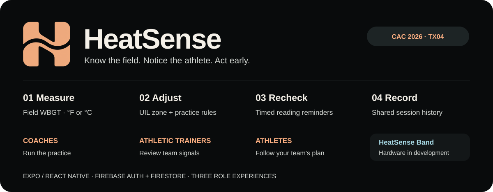
</p>

<p align="center">
  
  
  
  
  <a href="LICENSE"></a>
</p>

<p align="center">
  <b>Congressional App Challenge 2026 · Texas District 4 (TX04)</b>
</p>

<p align="center">
  <a href="#why-this-matters">Why</a> ·
  <a href="#how-it-works">How it works</a> ·
  <a href="#architecture">Architecture</a> ·
  <a href="#team-invites">Team invites</a> ·
  <a href="#data-model">Data model</a> ·
  <a href="#heatsense-band-hardware-in-development">Band</a> ·
  <a href="#screen-map">Screens</a> ·
  <a href="#repository-map">Repo map</a> ·
  <a href="#getting-started">Run it</a> ·
  <a href="#roadmap">Roadmap</a>
</p>

# HeatSense

**HeatSense helps Texas school coaches turn a field WBGT reading into a clear practice plan, follow through on it, and keep a record.**

> **In one line:** the UIL made WBGT heat protocols mandatory for every Texas school on August 1, 2026. HeatSense is the sideline tool that makes following them fast, provable and shared by the whole staff, with a wearable band in development to catch the athlete who is struggling before anyone sees it.

## Why this matters

Every August, Texas high school teams start practicing in some of the hottest conditions in the country. Starting **August 1, 2026**, the University Interscholastic League (UIL) made WBGT (wet-bulb globe temperature) protocols *required* for outdoor athletics and marching band. Schools now have to check WBGT within 15 minutes before practice, take more readings every 30 minutes under the conditions the plan lists, and change practice using UIL's activity chart. UIL also recommends writing the readings down. ([UIL 2026–27 heat stress plan](https://www.uiltexas.org/health/info/heat-stress-and-athletic-participation))

That is a lot to keep track of from the sideline with a clipboard. UIL's FAQ also says that schools near a Class 2/3 boundary should pick one class and use it all year, and that staff should look at trends, how long practice has been going, recovery, and how each athlete is doing, not only the latest number. ([UIL FAQ](https://www.uiltexas.org/health/info/heat-stress-and-athletic-participationWBGTs))

We built HeatSense so a coach can enter the reading, see what UIL says to do about it, and know when the next check is due. Everyone on the team works from the same record.

> [!IMPORTANT]
> HeatSense is **not a medical device** and does not diagnose heat illness. It helps staff follow their school's heat policy. A qualified adult always makes the call, following the school's emergency action plan.

## Who it's for

| | Who | What they need from HeatSense |
|---|---|---|
| 🧢 | **Coaches** | One screen that answers "can we practice, and how?", plus a reminder when the next reading is due. Coaches run field checks, create a team, and invite athletes. |
| 🩺 | **Athletic trainers** | The same reading and plan the coach sees. During a practice the coach started, they log WBGT readings and confirm guidance themselves, and they watch every athlete's vitals. |
| 🏃 | **Athletes** | Join their team with a code, set up a profile, and follow the team's practice session once approved. Health answers stay private to the athlete (see [Privacy & safety](#privacy--safety)). |

## HeatSense at a glance

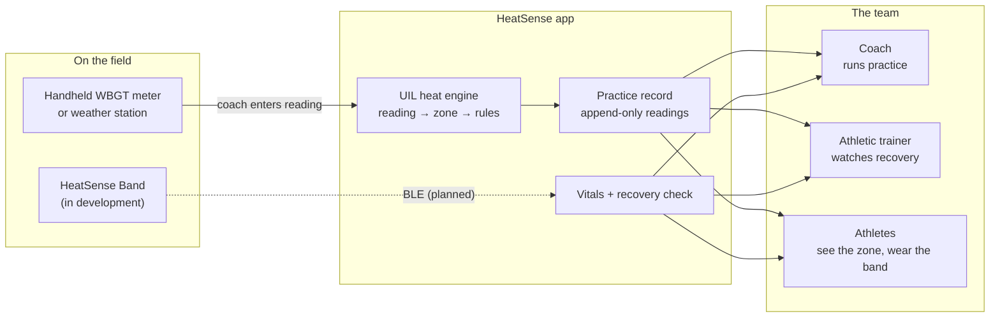

| | |
|---|---|
| **Problem** | Texas schools must adjust practice for heat using a WBGT chart (UIL). On a hot field, that means a meter, a printed chart, a stopwatch and memory. Nothing records what was done. |
| **What HeatSense does** | Turns one WBGT reading into the zone and the exact UIL rules, times the next recheck, keeps a tamper-proof record, and shows each athlete's recovery so staff can act early. |
| **Who uses it** | Coaches (run the practice), athletic trainers (watch recovery), athletes (see the zone, wear the band). |
| **Built with** | Expo / React Native (iOS, Android, web), Firebase Auth + Firestore on the free plan, security rules as the backend, an ESP32 wearable in development. |
| **By the numbers** | ~18,447 lines across screens, components, logic, services, state, rules and checks · 50 backend tests on the emulator · 4 calculation suites (UIL engine, rechecks, band simulator, plan check), plus auth regression checks · 3 role-specific apps · no custom server · Firebase Spark plan, subject to its usage limits |

### A coach's practice day

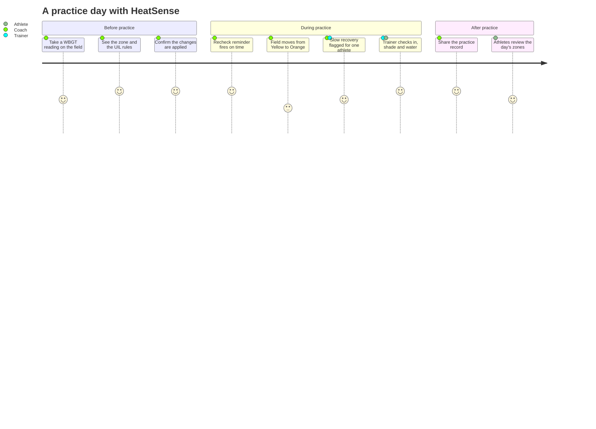

## Status at a glance

We want to be clear about what is real and what is not yet.

| | Feature | Notes |
|---|---|---|
| 🟢 **Works today** | Field check: WBGT reading → UIL zone → guidance → acknowledge → recheck → history → share | See [How it works](#how-it-works). The readings are entered by hand |
| 🟢 **Works today** | Firestore rules recompute the UIL zone and keep readings append-only | `firebase/firestore.rules`. 50/50 emulator tests pass (`npm run test:invites`) |
| 🟢 **Works today** | Sign-in with Google, or email and password (with password reset), through Firebase Auth | Android Google sign-in still needs release setup and device testing ([auth setup](docs/engineering/auth-setup.md)) |
| 🟢 **Works today** | Coach creates a team and gets a six-digit invite code; an athlete or athletic trainer joins; coach approves | Enforced by `firebase/firestore.rules`, with no server code (free Firebase plan) |
| 🟢 **Works today** | Athlete profile onboarding (profile → body → safety) | Profile saved to Firestore; health and contact answers are **not** saved in production yet |
| 🟢 **Works today** | iOS Live Activity / Dynamic Island practice widget | Shows the team's latest real reading, practice clock and next water break; the sample reading appears only in the offline sample build |
| 🟢 **Works today** | Heat alerts: recheck reminders and zone changes | Local notifications (`expo-notifications`), no server. Reminders fire with the app closed; zone-change alerts need the app running. See [Heat alerts](#heat-alerts) |
| 🟢 **Works today** | Coach Home | The session's latest real reading on the UIL zone scale; next reading / readings / applied; today's readings plotted over the zone bands; a week or month heat history (tap any day) |
| 🟢 **Works today** | Trainer Monitor and Athletes | Monitor: who needs attention (slow recovery, no signal, near max, early acclimatization) with Checked in, then a live tile grid. Athletes: searchable roster with each athlete's heat-acclimatization day (NATA 14-day guidance) and band status |
| 🟢 **Works today** | Protocols you work, not read | Respond (situation steps stamped with times, Call 911, cold-water immersion timer, incident log you can share), Prepare (daily readiness checks, editable emergency action plan), Tools (sweat-rate calculator, UIL zones). Kept on the phone |
| 🟢 **Works today** | Profile | Photo from library or camera, editable name, season stats (1M / 3M / All with change from the period before), band device card, notification switches wired to the real alerts |
| 🟢 **Works today** | Three role-specific apps: coach (team-centred), athlete (their own band, past practices), athletic trainer (logs readings, watches vitals) | See [Roles](#roles). Access is enforced in `firebase/firestore.rules` |
| 🧪 **Simulated** | Band vitals for a demo team (heart rate, skin temperature, sweat, movement, blood oxygen, recovery check), each with its own chart over the last 30 minutes | `src/lib/band-simulator.ts`. Every screen labels it **SIMULATED BAND DATA**; on by default only in builds without Firebase |
| 🔵 **Planned** | Custom (non-UIL) school heat policies | Every session already stores its policy version (`uil-wbgt@2025-26`), so a second policy can be added without migrating data |
| 🔵 **Planned** | Live sensor or weather-based WBGT | Today, every reading is typed in by a coach |
| 🟢 **Works today** | Band backend: pairing record and live practice vitals in Firestore | `src/services/band-vitals.ts`. An approved athlete's phone reports a sample every 30 s during practice; the coach and trainers read it, teammates can't; rules cap writes at one per 10 s. Samples are marked `simulated` until the firmware lands |
| 🛠️ **In development** | HeatSense Band wearable | Pairing flow in onboarding, a tested signal simulator, and the backend above. No firmware or Bluetooth code yet. See [HeatSense Band](#heatsense-band-hardware-in-development) |

## How it works

> [!NOTE]
> **Built.** This is the core loop of the app. It lives in `src/components/practice/field-check-sheet.tsx`, `src/lib/uil-wbgt.ts`, and `src/services/practice-sessions.ts`.

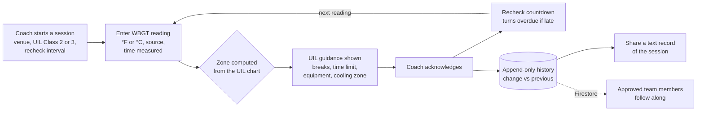

Step by step:

1. **Start a session.** The coach picks the venue, the school's UIL class (2 or 3), and how often to recheck (5–120 minutes).
2. **Enter a reading.** The coach enters the WBGT value in °F or °C, where it came from (handheld meter, weather station, or other), and when it was measured. °C is converted and rounded to 0.1 °F, the precision the UIL chart uses.
3. **See the zone and the guidance.** `classifyWbgt()` in `src/lib/uil-wbgt.ts` places the reading in a zone, and the screen shows what the UIL chart says for that zone.
4. **Acknowledge.** The coach confirms they've seen the guidance. The acknowledgment is saved with who did it and when.
5. **Recheck.** A countdown shows when the next reading is due and switches to an overdue state if it's missed.
6. **History.** Every reading stays in the session, shown with how it changed from the one before. Nothing is overwritten or deleted.
7. **Share.** The coach can share a plain-text record of the session. Late readings are marked in it.

Some decisions we made on purpose:

- **The server checks the math.** The app computes the zone, but `firebase/firestore.rules` has its own copy of the UIL thresholds. It recomputes the zone from `wbgtF` and the session's class, and rejects any reading whose zone doesn't match.
- **Readings are append-only.** Once saved, a reading can't be edited or deleted. The only allowed change is the coach's one-time acknowledgment. Sessions can only be ended, never edited.
- **Every reading records its source.** Each session stores the policy version (`uil-wbgt@2025-26`). Each reading stores the entered value and unit, the source, the time measured, and who recorded it.
- **Tested both ways.** `scripts/check-uil-wbgt.ts` checks the classifier against the chart, including the zone boundaries. The emulator suite (`npm run test:invites`, 50/50 passing) covers invites, access rules, and session/reading rules.

## Heat alerts

> [!NOTE]
> **Built.** `src/services/heat-alerts.ts` and `src/state/heat-alerts.ts`. No server: on the free plan the phone schedules its own notifications.

| Alert | Who gets it | When | Works with the app closed? |
|---|---|---|---|
| **WBGT recheck in 5 minutes** | Whoever logs readings: the coach and approved trainers | 5 minutes before the next reading is due | ✅ Scheduled on the phone ahead of time |
| **WBGT recheck is due** | Same | The moment the recheck interval runs out | ✅ |
| **The field moved into the Orange zone** | Everyone on the team except the person who entered the reading | When a new reading lands in a different zone than the one before | ⚠️ Needs the app running or recently open |
| **Marcus Lee: slow recovery** | The coach and approved trainers | Once per athlete per practice, when their band shows heart rate staying high through a break | ⚠️ Needs the app running or recently open |

- Every new reading reschedules the reminders; ending practice clears them.
- Each alert type has its own switch in Profile → Notifications; turning reminders off cancels the scheduled ones. Profile also sends a test alert.
- Permission is asked at the moment it makes sense: athletes on the onboarding *Heat alerts* screen, coaches when they start practice.
- **Trade-off:** a true push to a closed phone needs a server (Cloud Functions on the paid Blaze plan). The reminders, which matter most, already fire with the app closed.

## Roles

HeatSense is three apps in one, chosen on the role screen during onboarding. The coach's app is about the whole team; the athlete's is about themselves.

| | Coach | Athletic trainer | Athlete |
|---|---|---|---|
| Joins a team by | Creating it (gets the invite code) | Entering the coach's code, then approval | Entering the coach's code, then approval |
| Tabs | Plan · Team · **Home** · Alerts · Profile | Monitor · Athletes · **Home** · Protocols · Profile | Band · Sessions · **Home** · Learn · Profile |
| Home | Latest reading on UIL's zone scale, next reading/readings/applied figures, today's readings over the zone bands, week/month heat history | Same, plus *Add a reading* once the coach starts practice | Same reading, read-only, plus Your body (four vitals vs usual), their acclimatization and today's UIL rules |
| Vitals | Team tab: Roster (code, approvals, acclimatization, staff) and Live | Monitor: needs attention + live grid; Athletes: the roster | Band tab: five vitals, each with its own chart |
| Can record readings | Yes, and starts or ends practice | Yes, during a practice the coach started; can't start or end it | No (rules refuse) |
| Can invite | Yes, shares the code | No | No, only enters a code |

How each role finds its data (`src/state/team-session.ts`):

- **Coach:** `teams` where `coachUid == uid`, then the team's open session in `teams/{id}/sessions` and its `readings`.
- **Athlete and trainer:** their `teamMembers/{teamId}_{uid}` document with `status == 'active'`, then the same session and readings. The rules let active members read them and nothing more.
- **Athletes see their trainer** through a query for the team's active `trainer` memberships, which the rules allow; they cannot list other athletes.

## Architecture

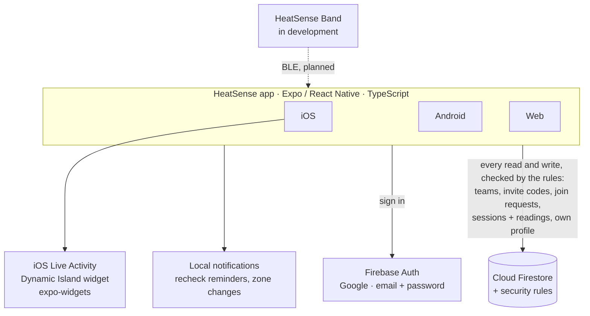

HeatSense has no server code: it runs on Firebase's free plan, and the app writes to Firestore directly. The security rules are the only gatekeeper, and they check every write field by field: who is a team's coach, which invite codes are live, that joining only ever creates a *pending* request, that only the coach approves it, and that every field reading carries the zone the rules calculate themselves.

### Engineering decisions

| Decision | Why | Trade-off we accepted |
|---|---|---|
| **No server: Firestore security rules are the backend** | $0 to run on the free Spark plan; one less thing to deploy, patch or get breached | Rules can't count attempts, so invite-code guesses aren't rate-limited (a guess only creates a request the coach must approve) |
| **The server recomputes every zone** | A modified app can't log a reading in the wrong zone; the record stays trustworthy | The UIL thresholds live in two places (`uil-wbgt.ts` and the rules), kept in step by tests |
| **Readings are append-only** | A practice record that can't be quietly edited after an incident | Typos stay in the record; the next reading supersedes them |
| **Local notifications instead of push** | Works on the free plan; the recheck reminders fire even with the app closed | Zone-change alerts need the app running |
| **Simulated band behind a clear label** | Lets coaches and judges see the vitals experience before the firmware exists | Every vitals screen says *SIMULATED BAND DATA* so nobody mistakes it for real |
| **Health answers stay off the server** | Many athletes are minors and there's no guardian-consent flow yet | Health and emergency answers are kept for the session only |
| **One band that travels through onboarding** | The product is the band: it lifts off the welcome screen, docks in the header on form screens and lands where each step needs it (`src/components/band/band-journey.tsx`) | One extra overlay layer above the navigator |

## Team invites

A team invite is a six-digit code. Joining with it never grants access by itself: it files a *pending* request that only the team's coach can approve.

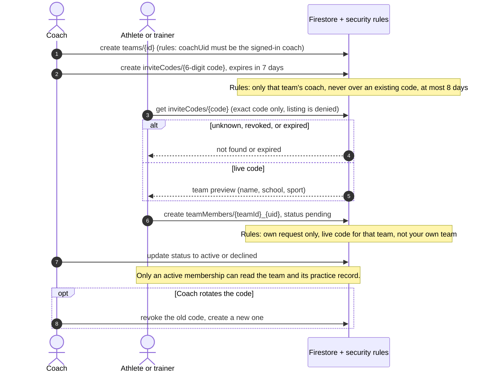

What `firebase/firestore.rules` enforces (each one is tested in `scripts/test-team-invites.mjs`):

- **Only a team's coach makes or revokes its codes.** A code can't overwrite another live code, and lasts at most 8 days.
- **Codes can't be listed.** The app can look up one exact code, never browse them.
- **A join request must be your own, pending, and use a live code for that team.** You can't approve yourself, join as someone else, pick a role other than athlete or trainer, or join your own team.
- **Only the coach approves or declines.** A declined person can ask again with a live code.
- **The trade-off of having no server:** the rules can't count attempts, so code guesses aren't rate-limited. A correct guess still only creates a pending request that the coach must approve. If the project moves to the paid Blaze plan, a server lookup or App Check can add rate limiting.

## Data model

These are the collections defined in `firebase/firestore.rules`.

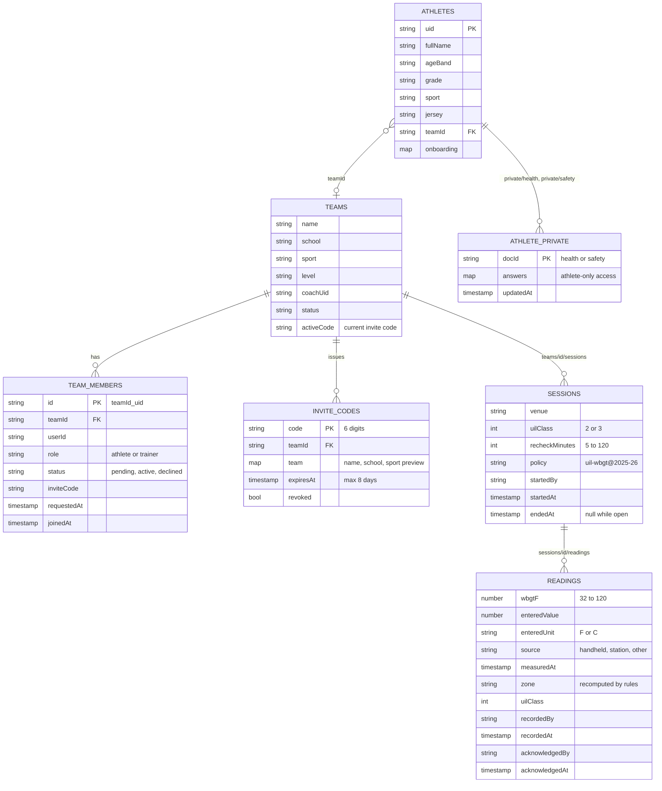

### Lifecycles

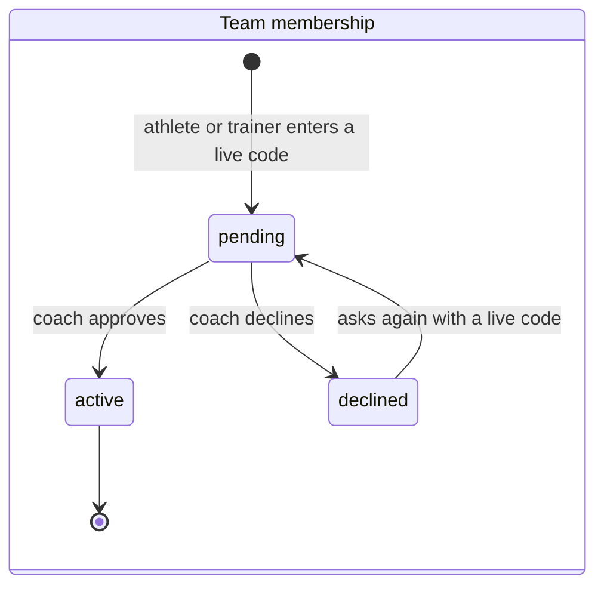

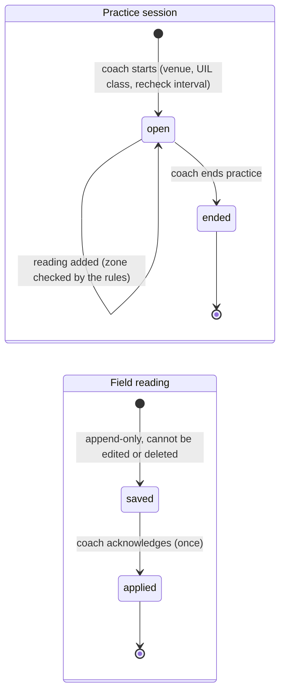

| Collection | Who can read it from the app | Who can write it |
|---|---|---|
| `teams` | The coach, and approved (active) members | The coach creates their own; edits only details and the active code |
| `teams/{id}/sessions` | The coach, and approved members | Coach creates; coach can only set `endedAt` once; no deletes |
| `teams/{id}/sessions/{id}/readings` | The coach, and approved members | Coach adds to an open session; zone must match the rules' own UIL calculation; only a one-time acknowledgment afterward; no edits or deletes |
| `teamMembers` | The person themselves, the team's coach, approved trainers; athletes can see their team's trainers | Anyone files their own pending request with a live code; only the coach approves or declines |
| `inviteCodes` | Anyone signed in, one exact code at a time (no listing) | The team's coach creates or revokes |
| `athletes/{uid}` | The athlete, and their coach once the athlete is approved | The athlete (every field validated) |
| `athletes/{uid}/private/*` | The athlete only, never the coach | The athlete only (production storage is off for now) |

## UIL WBGT zones

HeatSense uses the same five zones as UIL: green, yellow, orange, red, and black. The numbers below come from the official UIL chart, and the same values appear in `src/lib/uil-wbgt.ts` and `firebase/firestore.rules`. ([UIL 2025–26 WBGT chart](https://www.uiltexas.org/files/athletics/25-26WBGTChart.png))

```text
WBGT °F   78    80    82    84    86    88    90    92    94
          ├─────┼─────┼─────┼─────┼─────┼─────┼─────┼─────┤
Class 3   ░░░░░░░░░░░░▒▒▒▒▒▒▒▒▒▒▒▒▒▒▒▓▓▓▓▓▓▓▓▓██████■■■■■■   green <82.0 · yellow 82.0–86.9 · orange 87.0–90.0 · red 90.1–92.0 · black ≥92.1
Class 2   ░░░░░▒▒▒▒▒▒▒▒▒▒▒▒▒▒▒▓▓▓▓▓▓▓▓▓██████■■■■■■■■■■■■■   green <79.7 · yellow 79.7–84.6 · orange 84.7–87.6 · red 87.7–89.7 · black ≥89.8
                            ▲
          84 °F WBGT is Yellow in both classes
          ░ green  ▒ yellow  ▓ orange  █ red  ■ black
```

> [!NOTE]
> These values are **WBGT**, not air temperature or heat index. A 90°F afternoon is not the same as a 90°F WBGT reading.

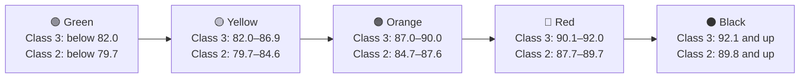

| Zone | Class 3 WBGT (°F) | Class 2 WBGT (°F) | What the UIL chart says to change |
|---|---|---|---|
| 🟢 Green | below 82.0 | below 79.7 | Normal activities. At least 3 rest breaks per hour, each at least 3 minutes. |
| 🟡 Yellow | 82.0–86.9 | 79.7–84.6 | Use discretion for intense or long exercise. At least 3 breaks per hour, each at least 4 minutes. An on-site rapid cooling zone (tub or tarp) is required. |
| 🟠 Orange | 87.0–90.0 | 84.7–87.6 | Practice limited to 2 hours. Football: helmet, shoulder pads, and shorts only. At least 4 breaks per hour, each at least 4 minutes. Cooling zone required. |
| 🔴 Red | 90.1–92.0 | 87.7–89.7 | Practice limited to 1 hour. Football: no protective equipment and no conditioning. 20 minutes of rest per hour. Cooling zone required. |
| ⚫ Black | 92.1 and up | 89.8 and up | No outdoor workouts. Wait until it is cooler. |

This table is a summary to help explain the app. A school should always follow the full UIL plan and its own heat policy. A school's WBGT class depends on where the school is, not on its congressional district. Schools near a boundary choose one class and keep it for the whole year (UIL FAQ).

> [!NOTE]
> **A bug we fixed:** older sample data labeled 84°F WBGT as **orange**. On the UIL chart, 84°F is **yellow** for both classes. The sample zone in `src/lib/practice.ts` is now computed by the same classifier, and `scripts/check-uil-wbgt.ts` tests this case.

## HeatSense Band (hardware, in development)

> [!WARNING]
> **In development.** Right now the band is a design and a parts list. **The repository contains no firmware and no Bluetooth code, and no BLE library is installed.** `src/app/pair-band.tsx` is a pairing screen whose search and pairing are *simulated* with short delays. Nothing below has been built or tested. The band does not and will not diagnose heat illness. Its signals are only meant to give a coach or athletic trainer extra awareness, alongside WBGT, which stays the primary input.

The HeatSense Band is a screenless wearable that an athlete wears on the wrist or upper arm, similar in shape to a WHOOP strap. It pairs with the HeatSense app. It would add a little individual context (pulse, movement load, and skin conductance) to the team-wide WBGT picture.

### What exists today vs. what's planned

| | Item |
|---|---|
| ✅ Exists | Pairing flow (`src/app/pair-band.tsx`): get ready → put on → pairing light → select → connect. Part of athlete onboarding and the athlete's Band tab. Search and connection are simulated |
| ✅ Exists | Signal simulator (`src/lib/band-simulator.ts`) that produces the same signals the band is designed to send, with a self-check (`scripts/check-band-simulator.ts`) |
| ✅ Exists | Vitals screens fed by the simulator: coach Team tab, trainer Monitor, athlete vitals detail (`src/app/athlete-vitals.tsx`), athlete Band tab |
| ✅ Exists | The band as an optional part of the product design. The app is fully usable without it |
| 🔵 Planned | Firmware for the ESP32 Nano (C++, Arduino framework, built with PlatformIO) |
| 🔵 Planned | A BLE library in the app, for example `react-native-ble-plx` (needs a native build, not Expo Go) |
| 🔵 Planned | The GATT service and packet format below, then versioning them |
| 🔵 Planned | Bench testing each sensor on its own, then on-body testing against a reference device |
| 🔵 Planned | A consent flow before any band data leaves the athlete's phone |

### Bill of materials

| Part | Role on the band | Interface |
|---|---|---|
| **ESP32 Nano** board | Microcontroller. Reads the sensors, builds packets, and runs the BLE radio | n/a, it is the host |
| **MAX30102** | Optical pulse sensor (PPG). Gives heart rate | I2C (default address 0x57) |
| **MPU6050** | 6-axis accelerometer + gyroscope. Gives movement and activity load | I2C (default address 0x68) |
| **GSR sensor** | Galvanic skin response (skin conductance). Used as a sweat-response trend | Analog voltage → ESP32 ADC pin |
| **LiPo battery** | Power | → charging module |
| **LiPo charging module** | Charges the battery safely and feeds the board | Battery in/out → board power input |

The two digital sensors have different I2C addresses, so they share one bus (SDA/SCL). The GSR sensor outputs an analog voltage, so it uses an ADC pin instead.

### Block and wiring diagram

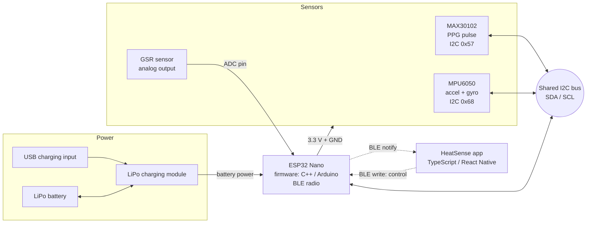

### Sensor signal chain

What each sensor measures, how the firmware is planned to turn it into a number, and where that number ends up in the app. Sampling settings are **planned starting points**, to be tuned on the bench.

| Signal | Sensor | Bus | Planned acquisition | Derived value | App field (`Vitals`) |
|---|---|---|---|---|---|
| Heart rate | MAX30102 (PPG, red + IR LEDs) | I2C `0x57` | 100 Hz, 4-sample averaging, IR channel | Beats per minute from peak-to-peak intervals over a ~8 s window; 0 when the signal is too poor | `heartRate` (bpm) |
| Movement | MPU6050 (accelerometer ± gyro) | I2C `0x68` | ±8 g accelerometer at 50 Hz | Mean of \|a\| − 1 g over 1 s, scaled 0–100 against 2 g | `movement` (0–100) |
| Sweat response | GSR module (two skin electrodes) | ESP32 ADC | 12-bit ADC (0–4095) at 10 Hz, 1 s average | Skin conductance in µS from the module's divider; a relative trend, not calibrated | `sweat` (µS) |
| Skin temperature | **Not in the current parts list** | n/a | n/a | The MAX30102's die temperature tracks the chip, not the skin, so it isn't used. Adding a dedicated sensor (for example MAX30205, I2C `0x48`, ±0.1 °C) is planned | `skinTempF` (°F) |
| Battery | LiPo via the board's ADC | ADC | Every 60 s | Percent from a voltage curve | `battery` (packet only) |

> [!IMPORTANT]
> The simulator already produces `skinTempF`, so the screens are ready for it, but the **current parts list cannot measure skin temperature**. Packet v2 below adds the field for when a skin sensor is added.

### Languages and tools

| Side | Language | Tools | Status |
|---|---|---|---|
| Band firmware | C++ | Arduino framework on ESP32, built with PlatformIO | Planned, no code yet |
| App | TypeScript | React Native / Expo, plus a BLE library such as `react-native-ble-plx` | Pairing UI exists; BLE layer planned |

### Firmware main loop (planned)

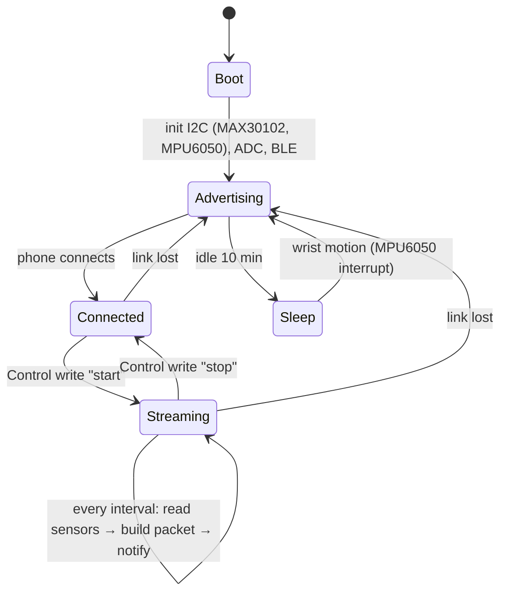

### Bluetooth Low Energy design (draft)

- **Roles:** the band is the **GATT peripheral** and advertises the HeatSense service. The phone is the **central**: it scans, connects, and subscribes.
- **One custom HeatSense service** (128-bit UUID, not assigned yet) with two characteristics:
  - **Data**: *notify*. The band pushes one small binary packet on a regular interval.
  - **Control**: *write*. The app sends simple commands, for example start/stop streaming, set the interval, or ask for the battery level.
- **Packets are binary and versioned**, so the app can reject or adapt to formats it doesn't understand, and the firmware can change without breaking older app builds.

**Draft packet schema (v1)**: little-endian, 13 bytes, which fits in one default-size BLE notification.

| Offset | Field | Type | Meaning |
|---|---|---|---|
| 0 | `version` | uint8 | Packet format version (1) |
| 1 | `sequence` | uint16 | Counts up by one per packet and wraps around. Gaps show dropped packets |
| 3 | `timestamp` | uint32 | Seconds since the band started (the app maps this to wall-clock time) |
| 7 | `heartRate` | uint8 | Beats per minute, 0 = no valid reading |
| 8 | `motion` | uint16 | Movement, 0–100 (see the signal chain above) |
| 10 | `gsr` | uint16 | Raw GSR level from the ADC (relative trend, not calibrated) |
| 12 | `battery` | uint8 | Battery percent, 0–100 |

> This schema is a **draft**. Field sizes, units, and the interval will change once we test real hardware.

**Draft v2** appends two fields (15 bytes, still one notification): `skinTemp` int16 at offset 13 (hundredths of a °C, `0x7FFF` = no sensor) and `flags` uint8 at offset 15 (bit 0: on-wrist contact, bit 1: charging).

**Planned decode in the app.** Packets become the same `Vitals` shape the simulator produces today, so the screens don't change when real data arrives:

```ts
// Planned: src/lib/band-packet.ts. Not in the repo yet.
function decodePacket(bytes: DataView): Vitals | null {
  const version = bytes.getUint8(0);
  if (version !== 1 && version !== 2) return null;        // unknown format: reject, don't guess
  const heartRate = bytes.getUint8(7);                     // 0 = no valid reading
  const motion = bytes.getUint16(8, true);
  const gsr = bytes.getUint16(10, true);
  const skinC = version >= 2 ? bytes.getInt16(13, true) : 0x7fff;
  return {
    heartRate,
    movement: Math.min(100, motion),
    sweat: gsrToMicrosiemens(gsr),                         // raw ADC → µS, calibrated per module on the bench
    skinTempF: skinC === 0x7fff ? NaN : (skinC / 100) * 1.8 + 32,
    phase: 'work',                                         // set from the practice plan, not the band
  };
}
```

### Recovery check

The one judgment the vitals screens make, in `recoveryStatus()` (`src/lib/band-simulator.ts`). It runs only during a rest block:

1. Wait until the athlete is at least **4 minutes into the rest block**. Earlier than that, the status is always "usual".
2. Take **peak**, the heart rate at the end of the work block, and **floor**, the expected resting level for the conditions: resting HR + 30 + 12 × heat load (0 in Green up to 1 in Black).
3. Recovery = (peak − current HR) ÷ (peak − floor). Below **0.6** (less than 60% of the way back), the status is **"watch"**, which shows "Slow recovery" on the vitals screens and an alert for the coach.

It's a prompt to check on someone, **not a diagnosis**, and the screens say so.

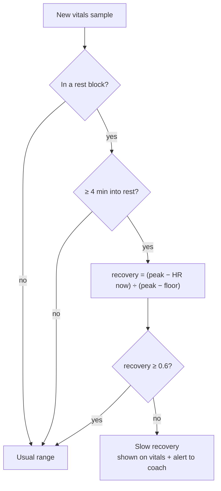

```text
 bpm
 170 ┤
 163 ┤○○  ○○○○○ ○○ ○○○○○○ ○                            ○○○○○○ ○○ ○
 155 ┤●●◐◐●●●●●◐●●◐●●●●●●◐ ○○○                    ○◐○◐◐●●●●●●◐●●◐●
 148 ┤                    ●   ○                  ○● ●
 141 ┤                         ○○○              ◐●
 134 ┤                     ●●     ○○○○○○       ○
 126 ┤                                  ○○○○   ●          ← Marcus still ~120 bpm
 119 ┤                       ●              ○○○              six minutes into rest:
 112 ┤                        ●●              ●              flagged "slow recovery"
 105 ┤                          ●●●●  ●
  97 ┤                              ●● ●●●●●●●            ← Jordan back near resting
  90 ┤
     └─────────────────────────────────────────────────────────────
      ◄──── work (20 min) ────►◄──── rest (10 min) ────►◄─ work ──►
      ● Jordan (typical recovery)   ○ Marcus (slow recovery)   ◐ both
```
*Generated from `src/lib/band-simulator.ts` (Yellow zone, one 20/10 work-rest cycle). Simulated data.*

### Band simulator (stands in for the firmware)

Until there's firmware, `src/lib/band-simulator.ts` produces each demo athlete's signals from the practice rhythm and the field's heat. It's deterministic (no randomness), so the demo is repeatable and testable. With *h* = heat load (0 Green → 1 Black) and *t* in minutes:

| Signal | Model |
|---|---|
| Heart rate, work block | floor + (peak − floor) · (1 − e^(−t/1.2)) |
| Heart rate, rest block | floor + (peak − floor) · e^(−0.55 · r² · t), where *r* is the athlete's recovery speed (1 = typical) |
| Peak / floor | peak = 150 + 18h + 8(1 − r); floor = resting HR + 30 + 12h |
| Skin temperature | 91.5 + 3h + min(1.6, t/40) + 0.4 in work (°F) |
| Sweat | 2 + 9h + min(4, t/15) + 1.5 in work (µS) |
| Movement | 72 in work, 12 in rest, ± a small smooth wobble |

The live demo team (`src/state/demo-team.ts`) runs practice time at **10×**, so a full 20/10 work-rest cycle plays out in 3 minutes, and one athlete (*r* = 0.45) is built to recover slowly so the "slow recovery" path can be seen. `scripts/check-band-simulator.ts` checks that every signal stays in a plausible range in every zone, that work raises heart rate and rest lowers it, that heat costs something, and that the slow athlete (and only that athlete) gets flagged.

When firmware exists, `decodePacket()` replaces the simulator as the source of `Vitals`, and nothing downstream changes.

### Data flow (planned)

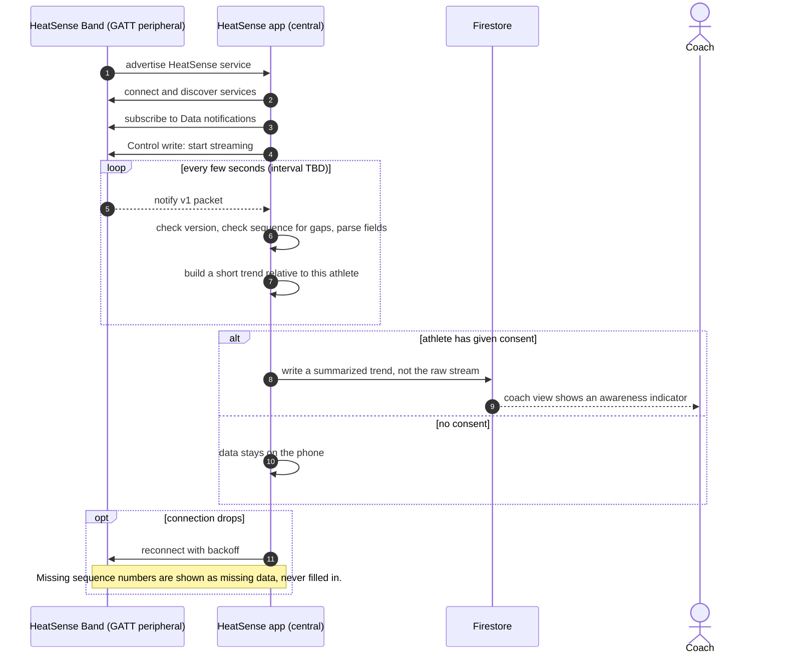

### Design goals for connection problems

- **Reconnect automatically** with increasing delays, without the athlete doing anything.
- **Never fake data.** Gaps in `sequence` are shown as gaps. A missing reading is never filled in or guessed.
- **Show staleness clearly.** If no packet has arrived recently, the app says "no recent band data" instead of showing an old number as current.
- **The app keeps working without the band.** WBGT checks, guidance, and history work the same whether or not a band is paired.
- **Battery awareness.** Warn the athlete when the battery is low, before a practice, not during one.

## Screen map

Routes come from `src/app/` (Expo Router, file-based).

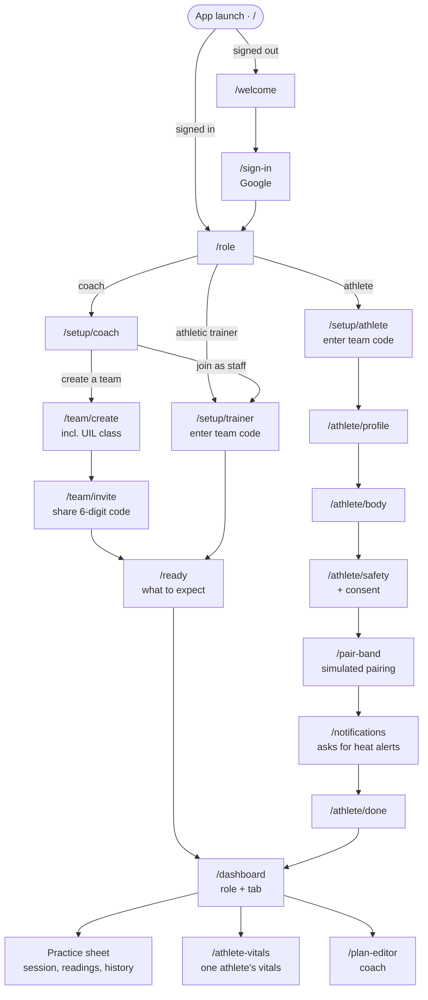

The practice sheet opens over the dashboard rather than as its own route.

## Screenshots

Captured from the iOS Simulator (iPhone 17 Pro Max). Dashboard screens run in sample mode; vitals are **simulated** and labelled as such in the app.

**Onboarding.** The band travels from screen to screen and lands where each step needs it.

| Welcome | Choose a role | Pair the band | Coach Today |
|:---:|:---:|:---:|:---:|
| 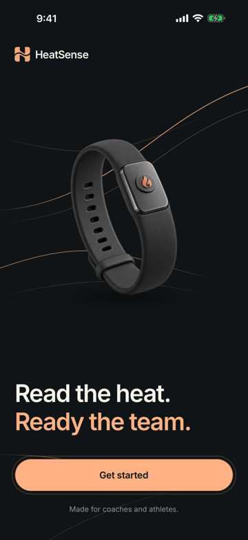 | 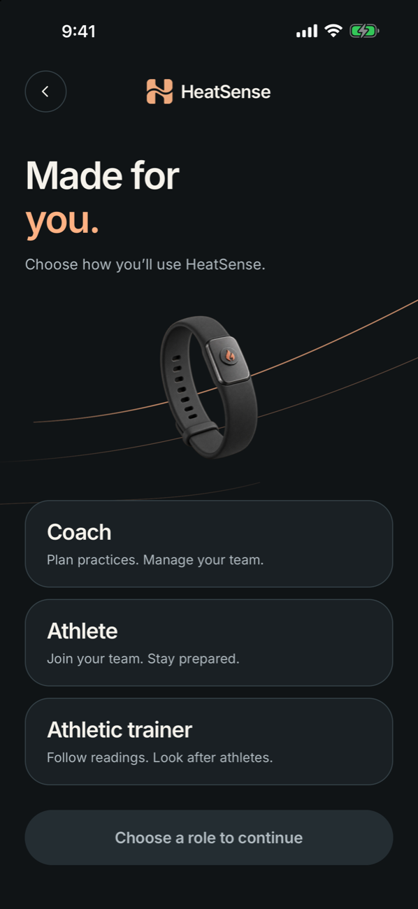 | 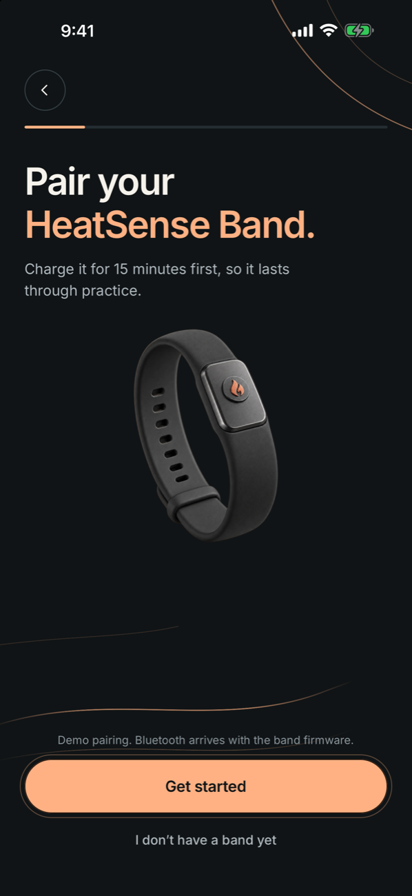 | 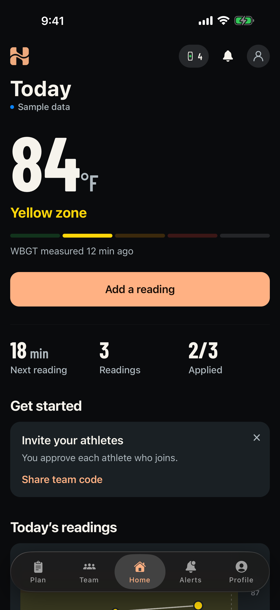 |
| Read the heat. Ready the team. | Coach, athlete or athletic trainer | Part of athlete onboarding | The reading, the zone, the next recheck |

**Coach.** Today's heat in context, the team to run, what needs attention, the rules.

| Heat history | Team | Alerts | Plan |
|:---:|:---:|:---:|:---:|
| 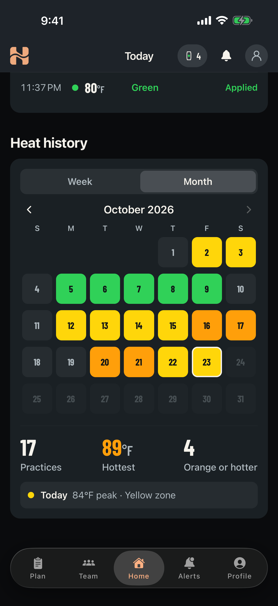 | 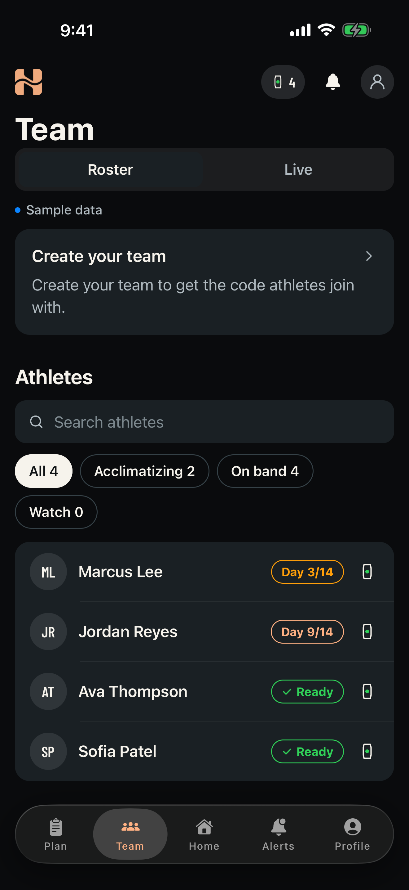 | 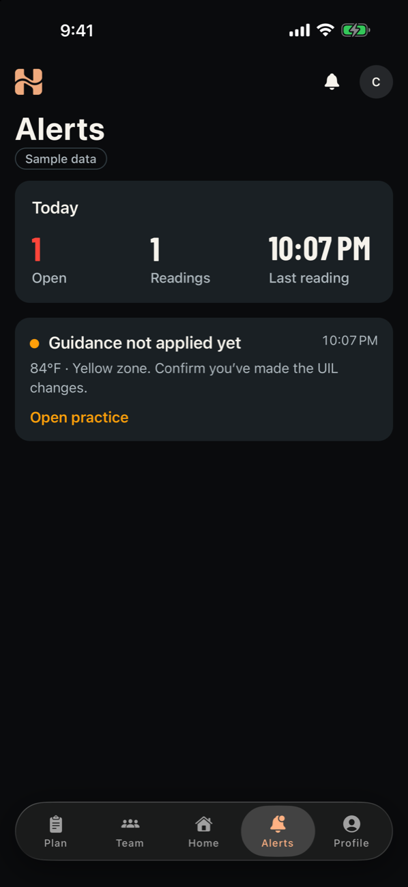 | 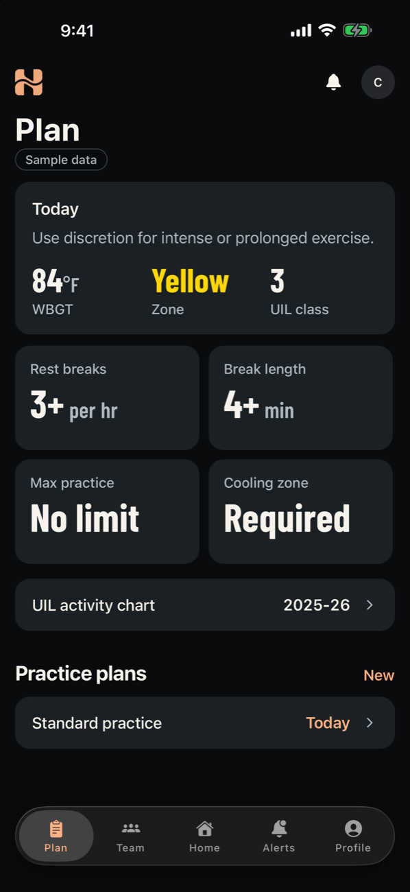 |
| Week strip or month calendar, tap any day | Roster and a live view | Live countdown, resolve or act | Today's UIL rules |

**Athletic trainer.** The live sideline, the roster, one athlete in depth, and protocols to work.

| Monitor | Athletes | Athlete detail | Protocols |
|:---:|:---:|:---:|:---:|
| 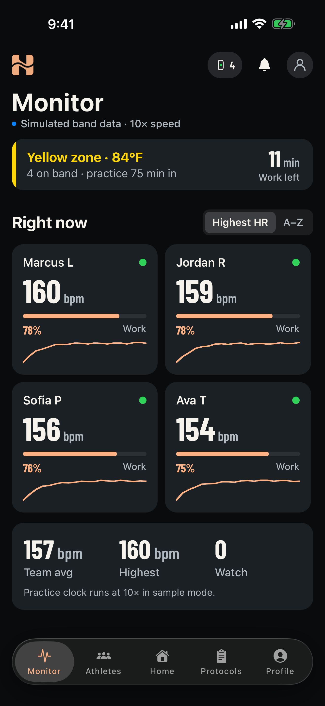 | 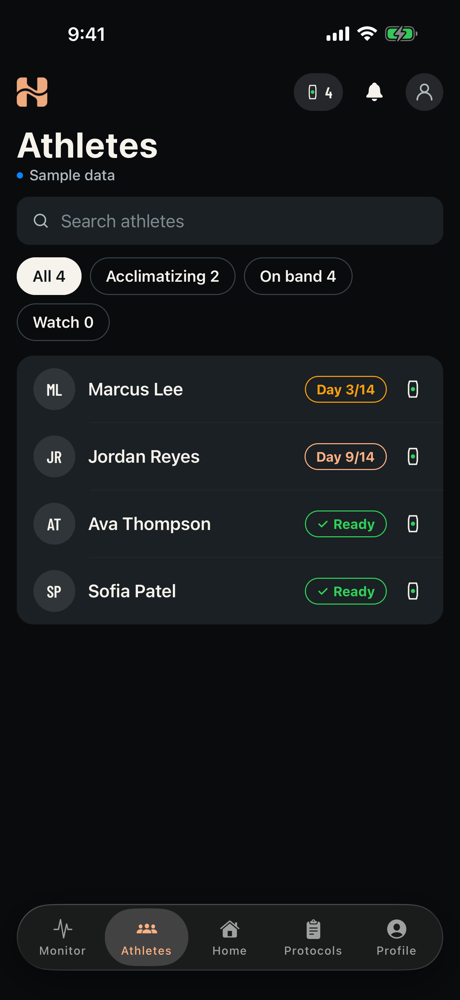 | 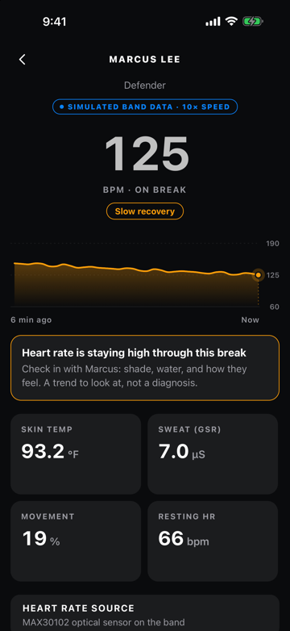 | 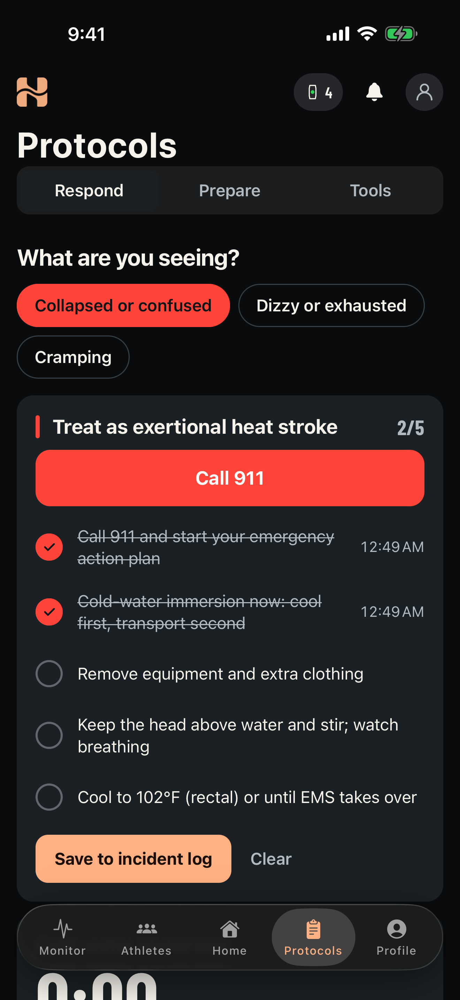 |
| Who needs attention, then everyone | Acclimatization and band at a glance | 14-day acclimatization, five vitals | Steps, 911, immersion timer |

**Athlete.** Their body, their band, what to do, their season.

| Today | Band | Learn | Profile |
|:---:|:---:|:---:|:---:|
| 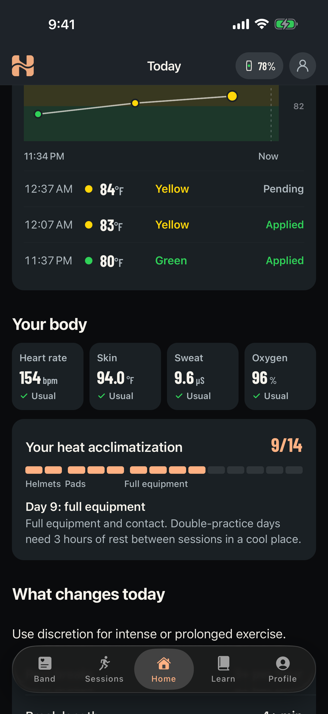 | 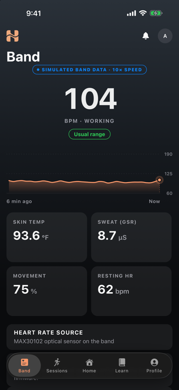 | 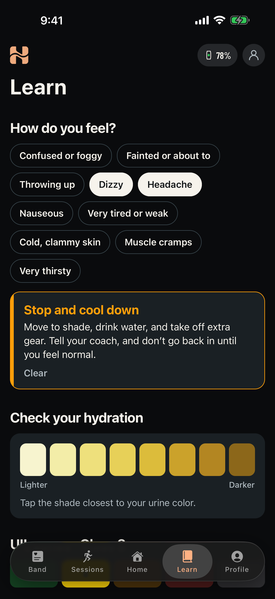 | 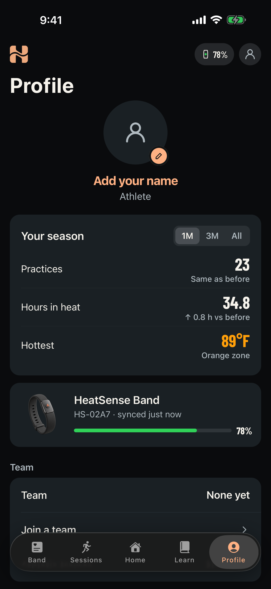 |
| Your body and acclimatization | Five vitals, each its own chart | How do you feel? Hydration | Photo, season, band, alerts |

## Repository map

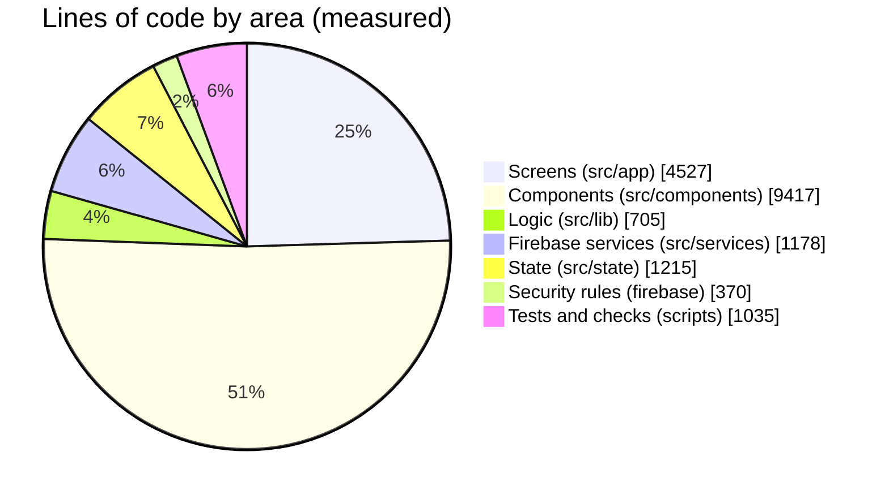

```text
heatsense/
├── src/
│   ├── app/                     Expo Router routes: welcome, sign-in, role/setup, dashboard,
│   │                            plan editor, practice records and athlete detail screens
│   ├── components/
│   │   ├── dashboard/
│   │   │   ├── coach/           Coach Home, Plan, Team and Alerts
│   │   │   ├── athlete/         Athlete Home, Band, Sessions, Learn and acclimatization
│   │   │   ├── trainer/         Trainer Home, Monitor, Athletes and Protocols
│   │   │   └── *.tsx            Shared shell, scroll, profile, states and role composition
│   │   ├── practice/            Field-check sheet, WBGT hero, heat calendar and timelines
│   │   ├── band/                Band viewer, onboarding journey, illustrations and vitals
│   │   ├── branding/            Actual HeatSense H mark and its assembly animation
│   │   ├── onboarding/          Entry screens, controls, fields and visuals
│   │   ├── layout/              Mobile viewport and phone framing
│   │   ├── motion/              Press scale, fills, floating band and segmented controls
│   │   └── ui/                  Buttons, text, surfaces, lists, charts and data displays
│   ├── constants/               Palette, typography, sports and public Firebase client IDs
│   ├── lib/                     UIL WBGT classifier, plan checks, rechecks, band simulator,
│   │                            practice activity and motion helpers
│   ├── services/                Firebase Auth, email/Google sign-in, Firestore teams,
│   │                            invites, practice records, athlete profiles and notifications
│   ├── state/                   Account, role, preferences, team/session and demo signal state
│   ├── widgets/                 PracticeActivity.tsx: iOS Live Activity / Dynamic Island
│   └── types/                   Small type declarations
├── firebase/
│   ├── firestore.rules          Authorization, data validation and server-side zone checks
│   └── firestore.indexes.json   Query indexes
├── scripts/                     Auth/config checks, UIL/recheck/plan/band assertions,
│                                emulator integration tests, local fixtures and capture tools
├── docs/
│   ├── engineering/             Architecture, development, auth setup and maintenance
│   ├── design/
│   │   ├── system/              Current design system, motion and UI contracts
│   │   ├── research/            Design references and research records
│   │   ├── audits/              Dated screen, interaction and runtime audits
│   │   ├── manifests/           Design tokens and route capture manifest
│   │   └── concepts/            Exploratory artwork; excluded from runtime assets
│   ├── research/                CAC TX04 research and submission planning
│   ├── screenshots/             Saved screenshots for review
│   └── archive/                 Earlier project overviews and handoffs
├── assets/                      Runtime app art, band render, README banner and font licenses
├── ios/                         Expo native iOS project and widget target
├── public/                      Web assets and generated Skia runtime
├── .github/workflows/           Existing auth preflight, source checks and web export
├── app.json                     Expo app IDs, icons, plugins and platform configuration
├── firebase.json                Firebase rules/index paths and local emulator ports
├── package.json                 Dependencies and development/check commands
├── tsconfig.json                Strict TypeScript and @/ source alias
├── eslint.config.js             Expo ESLint configuration
├── knip.jsonc                   Expo/Router-aware unused-code checks
├── .env.example                 Optional public client overrides and local-mode examples
└── LICENSE                      MIT
```

## Tech stack

```text
┌─────────────────────────────────────────────────────────────────────────┐
│  HeatSense Band (in development)   ESP32 · MAX30102 · MPU6050 · GSR    │
│  C++ / Arduino / PlatformIO        BLE GATT peripheral                 │
└──────────────────────────────────▲──────────────────────────────────────┘
                                   │ BLE notify (planned)
┌──────────────────────────────────┴──────────────────────────────────────┐
│  App (iOS · Android · web)          Expo SDK 57 · React Native 0.86    │
│  Screens       Expo Router (file-based, typed routes)                  │
│  Logic         UIL heat engine · band simulator · recovery check       │
│  Motion        Reanimated 4 · React Native SVG                         │
│  iOS extras    Live Activity / Dynamic Island (expo-widgets)           │
└──────────────────────────────────▲──────────────────────────────────────┘
                                   │ Firebase JS SDK (Auth + Firestore)
┌──────────────────────────────────┴──────────────────────────────────────┐
│  Firebase (free Spark plan, no servers)                                │
│  Auth: Google + email     Firestore: teams, codes, sessions, readings  │
│  Security rules: the backend. They validate every write.               │
└─────────────────────────────────────────────────────────────────────────┘
```

| Layer | Technology | Version | Why we chose it |
|---|---|---|---|
| Language | TypeScript | ~6.0 | One typed language for screens, logic, services and tests |
| App framework | Expo + React Native | Expo ~57.0, RN 0.86.3, React 19.2.3 | One codebase for iOS, Android and web; native builds when we need native modules |
| Navigation | Expo Router | ~57.0 | File-based routes: each screen is a file in `src/app/` |
| Auth | Firebase Auth + Google Sign-In | firebase ^12.4, google-signin ^16.1 | Students and staff already have school Google accounts |
| Database | Cloud Firestore | (firebase ^12.4) | Live listeners keep every phone on the team in sync |
| Backend | Firestore security rules | rules v2 | Free plan, nothing to host; the rules validate every field and recompute every zone |
| Motion | React Native Reanimated | 4.5.1 | Runs animations on the UI thread; built-in Reduce Motion support |
| Graphics | React Native SVG, Skia | 15.15, ^2.6 | Charts |
| iOS extras | expo-widgets | ~57.0 | Practice Live Activity / Dynamic Island |
| Device | expo-location, expo-maps, expo-crypto | ~57.0 | Practice location; secure random invite codes |
| Testing | Firebase Emulator Suite, firebase-admin, Node test scripts | firebase-admin ^14.5 | 50 backend tests against the real rules; self-checks for the heat engine, band simulator and plan check |
| Hardware (planned) | ESP32, C++, Arduino framework, PlatformIO, react-native-ble-plx | n/a | Low-cost BLE microcontroller with standard I2C sensors |

## Getting started

These steps take a fresh Mac from nothing to HeatSense running in the iPhone Simulator. Each step says what you should see, so you know it worked.

### 1. Install the tools (one time)

| Tool | Version | How to check | Where to get it |
|---|---|---|---|
| macOS + Xcode | Xcode 26 or newer, with an iOS Simulator | `xcodebuild -version` | Mac App Store → Xcode. Open it once and let it install components |
| Node.js | 22.13 or newer | `node --version` | [nodejs.org](https://nodejs.org) (LTS) |
| npm | comes with Node | `npm --version` | — |
| Git | any recent | `git --version` | Comes with Xcode's command line tools |
| Java | 21 or newer (only for the backend tests) | `java -version` | [adoptium.net](https://adoptium.net) |

Android Studio is only needed for Android; a browser is enough for the web build.

### 2. Get the code

```bash
git clone https://github.com/s-k-28/heatsense.git
cd heatsense
npm install
```

✅ You should see `added … packages` and no `ERR!` lines. Warnings are fine.

### 3. Firebase and sign-in

Email/password sign-in works on a fresh install without a local `.env` file. The app bundles the same **public client identifiers** as `.env.example` in `src/constants/firebase-client.json`; Firebase Auth and Firestore rules still enforce identity and access. No admin credential is bundled.

1. For Google OAuth configuration, a different Firebase project or local emulator testing, copy the optional template: `cp .env.example .env.local`.
2. The values in `.env.example` already point at the team's Firebase project (`heatsense-aa3c8`). To use your own project, replace them with the values from **Firebase console → Project settings → Your apps**:

| Variable | What it is |
|---|---|
| `EXPO_PUBLIC_FIREBASE_API_KEY` | Identifies the app to Firebase (public by design; the security rules protect the data) |
| `EXPO_PUBLIC_FIREBASE_AUTH_DOMAIN` | `<project-id>.firebaseapp.com` |
| `EXPO_PUBLIC_FIREBASE_PROJECT_ID` | The Firebase project ID |
| `EXPO_PUBLIC_FIREBASE_APP_ID` | The web app's ID |
| `EXPO_PUBLIC_FIREBASE_MESSAGING_SENDER_ID` | The project number |
| `EXPO_PUBLIC_GOOGLE_WEB_CLIENT_ID` | Google Sign-In OAuth client (web) |
| `EXPO_PUBLIC_GOOGLE_IOS_CLIENT_ID` | Google Sign-In OAuth client (iOS) |

Local `.env` files are gitignored, so they never get committed. If overriding Firebase, supply the complete configuration; partial custom projects are rejected rather than mixed with HeatSense defaults. Google Sign-In setup is explained step by step in [docs/engineering/auth-setup.md](docs/engineering/auth-setup.md).

3. **Using your own Firebase project?** Turn on both sign-in methods: **Firebase console → Authentication → Sign-in method → Google** and **→ Email/Password**. The team project already has both on.

> [!TIP]
> Trying a development build on a physical iPhone? With no emulator flags set, email/password sign-in uses the hosted HeatSense project. Emulator accounts are separate from hosted accounts. Restart Metro with `npm start -- --dev-client --clear` after changing environment values, then reload the app. Developer Mode alone does not configure Firebase.

### 4. Run the app

```bash
npm run ios        # builds and opens the iPhone Simulator (first build: about 5–10 minutes)
npm run android    # Android emulator
npm run web        # web browser
```

✅ The Simulator opens on the HeatSense launch screen, the H assembles, and the welcome screen shows the band. Edits to the code reload instantly while it runs.

> [!IMPORTANT]
> **Pulled a change that adds a native module** (for example `expo-notifications`)? Rebuild once with `npm run ios`. A JavaScript reload alone isn't enough, and the old build crashes with *Cannot find native module*.

### 5. Run the backend tests

```bash
npm run test:invites
```

This starts local Firebase emulators (Auth + Firestore), runs 50 tests against the real security rules, and shuts them down.

✅ The last line reads `50 passed, 0 failed`.

### 6. Deploy the security rules (team leads only)

```bash
npx -y firebase-tools@14 login                 # one time, opens a browser
npx -y firebase-tools@14 deploy --only firestore:rules,firestore:indexes --project heatsense-aa3c8
```

✅ `Deploy complete!` Everything runs on the free Spark plan; there are no Cloud Functions to deploy.

### Checks before pushing

```bash
npx tsc --noEmit                          # type errors → should print nothing
npm run lint                              # style and React rules → 0 errors
npm run check:auth                        # public client and OAuth configuration
npm run check:email-auth                  # fresh-install auth regression
npm run check:unused                      # Expo/Router dependency and file checks
npm run check:docs                        # maintained documentation links
node scripts/check-uil-wbgt.ts            # heat engine → "all checks passed"
node scripts/check-band-simulator.ts      # band model → "all checks passed"
node scripts/check-plan-check.ts          # plan vs UIL → "all checks passed"
npm run test:invites                      # backend rules → "50 passed, 0 failed"
```

### Troubleshooting

| What you see | Why | Fix |
|---|---|---|
| "Sign-in is unavailable in this sample build" | An older bundle had no Firebase config | Pull the latest `main`, restart Metro with `npm start -- --dev-client --clear`, then reload. The current build includes public Firebase defaults. |
| "Firebase configuration is incomplete" | Only some custom Firebase values are set | Supply all four required client values, or remove all Firebase overrides to use the HeatSense defaults; restart Metro. |
| Sign-in cannot connect on a physical phone | Emulator flags are enabled, or the phone cannot reach the chosen server | For hosted accounts, remove both emulator flags and restart Metro. Local emulators are loopback-only by default; a phone cannot use its own `127.0.0.1` to reach your Mac. |
| Changes don't show up in the Simulator | The dev server stalled | Stop it, run `npx expo start --dev-client --clear`, relaunch the app |
| Google sign-in fails | OAuth client IDs don't match the project | Follow [auth-setup.md](docs/engineering/auth-setup.md) |
| "Email sign-in isn't turned on for HeatSense yet" | Email/Password provider is off in your Firebase project | Firebase console → Authentication → Sign-in method → Email/Password → Enable |
| App crashes on launch: *Cannot find native module* | A native dependency was added since your last build | `npm run ios` to rebuild |
| No heat alerts | Notification permission was declined | iPhone Settings → HeatSense → Notifications |
| `test:invites` says Java not found | The emulators need Java 21+ | Install Java (step 1) |
| `firebase deploy` says "Failed to authenticate" | The CLI isn't logged in on this computer | Run `npx -y firebase-tools@14 login` in your own Terminal (it needs a browser) |
| A write fails with `permission-denied` | The security rules refused it, on purpose | Check the rules for that collection in `firebase/firestore.rules` |

## Privacy & safety

- **Not a medical device.** HeatSense helps staff follow their school's heat policy. It does not diagnose anyone, and a qualified adult always makes the decision.
- **Health data is not saved in production.** We don't have a parent/guardian consent flow or a published privacy notice yet, and many athletes are minors. Because of that, `HEALTH_STORAGE_APPROVED = false` in `src/services/athlete-health.ts`, and health and emergency-contact answers stay in memory for the session only. Storage only runs against the local emulators so we can test the rules. (This is a client flag; we still need to enforce it on the server too.)
- **Coaches can't see health answers.** Even when storage is on, `athletes/{uid}/private/*` can be read only by the athlete. The rules enforce this, not just the UI.
- **Readings can't be quietly changed.** Field readings are append-only, and the server checks every zone.
- **Band data will need consent first.** Under the planned design, band data stays on the athlete's phone unless they consent, and even then only a summary is shared.
- **No server, no stored IP addresses.** The app talks only to Firebase Auth and Firestore.

## Roadmap

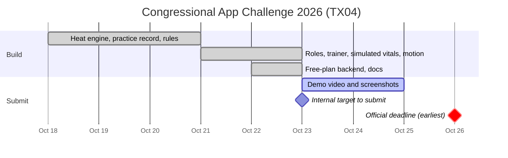

**Contest build**
- [x] Manual WBGT entry with units, source, and measurement time
- [x] UIL class selection, with the policy version saved on each session
- [x] Zone and guidance from a deterministic, tested classifier (`src/lib/uil-wbgt.ts`)
- [x] Server-side zone check and append-only readings in Firestore rules
- [x] Coach acknowledgment, recheck countdown, and overdue state
- [x] Session history synced to the team through Firestore, with a shareable text record
- [x] Coach Home shows the session's latest reading (zone scale, practice figures, alerts)
- [x] Coach, athlete and athletic-trainer roles, enforced by the rules
- [x] Simulated band vitals with a recovery check, clearly labelled
- [x] Free-plan backend: rules-only, no Cloud Functions
- [x] Live Activity shows the session's latest real reading
- [x] Heat alerts: recheck reminders and zone changes (local notifications)
- [x] Email and password sign-in alongside Google
- [x] Athletic trainers log readings during a practice; athletes see past practices with peak heat
- [ ] Have a local coach or athletic trainer review how we interpret the UIL chart

**Next**
- [ ] Weather-based WBGT estimates as a second, clearly labeled source
- [ ] Parent/guardian consent flow and privacy notice, then turn health storage on
- [ ] Android release setup and testing on real devices
- [ ] Rate limiting or App Check for invite-code lookups (needs a server, so the Blaze plan)

**HeatSense Band: in development**
- [ ] Bench-test each sensor (MAX30102, MPU6050, GSR) on the ESP32 Nano
- [ ] Firmware v0: read sensors, build v1 packets, BLE notify
- [ ] Add a skin-temperature sensor (for example MAX30205) and packet v2
- [ ] App BLE layer: scan, pair, subscribe, `decodePacket()`, reconnect, replacing the simulator as the `Vitals` source
- [ ] Consent flow before any band data is shared
- [ ] On-body testing against a reference heart-rate device

## Team

<!-- TEAM: fill in -->
| Name | Role | What they built |
|---|---|---|
| <!-- TEAM: fill in --> | | |

### AI-use disclosure

The 2026 Congressional App Challenge rules allow AI tools if teams fully disclose how they used them, make significant contributions themselves, and understand the technology.

<!-- TEAM: fill in — which AI tools were used, for what parts (code, design, docs, this README), and what the team wrote, reviewed, and tested themselves. -->

## More docs

- [Engineering architecture](docs/engineering/architecture.md)
- [Development and verification](docs/engineering/development.md)
- [Documentation index](docs/README.md)
- [CAC TX04 research and submission plan](docs/research/cac-tx04-research-2026.md)
- [UI product contract](docs/design/system/ui-product-contract.md)
- [Design system](docs/design/system/design-system.md)
- [Design reference map](docs/design/research/design-reference-map.md)
- [Firebase and Google sign-in setup](docs/engineering/auth-setup.md)
- [Session handoff, September 15, 2026 (archived)](docs/archive/agent-session-handoff-2026-09-15.md)

## License

[MIT](LICENSE)
