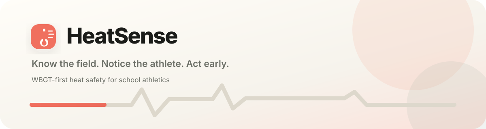
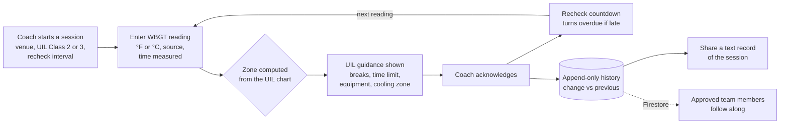
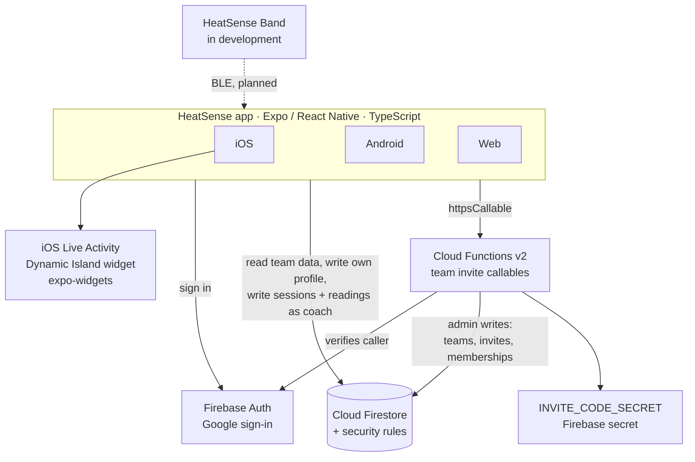
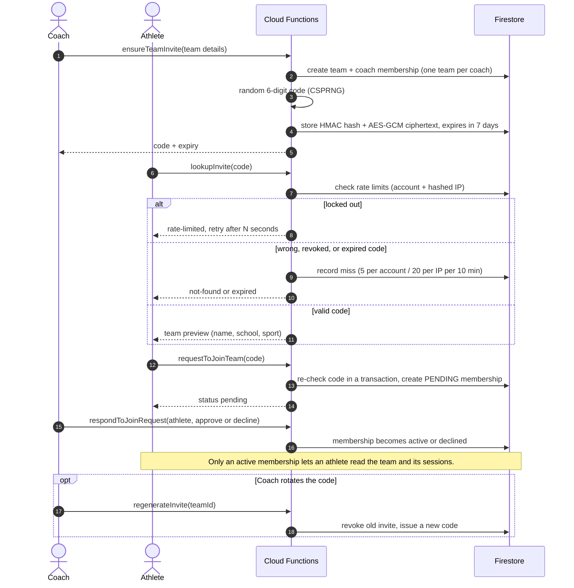
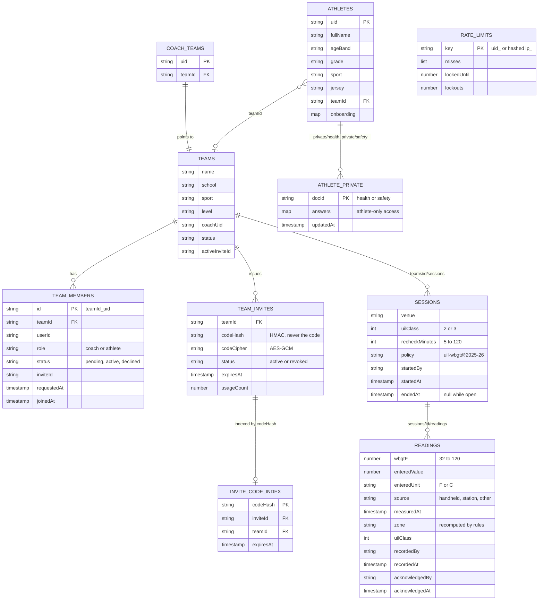
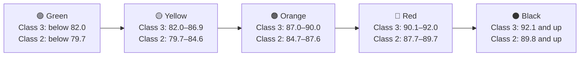
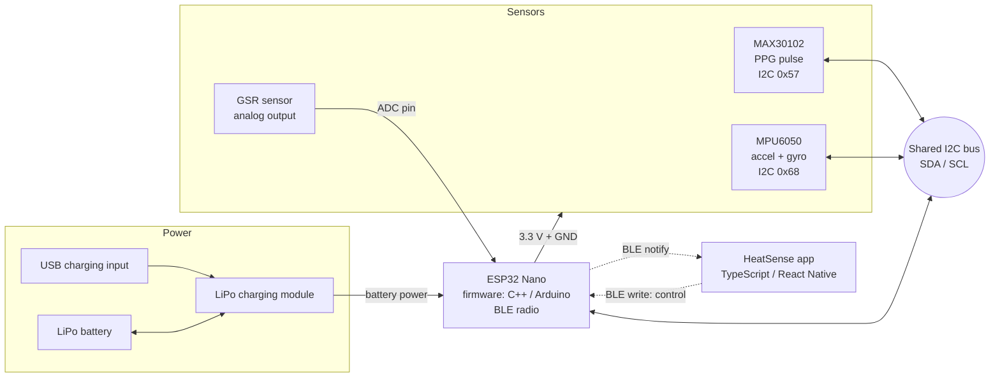
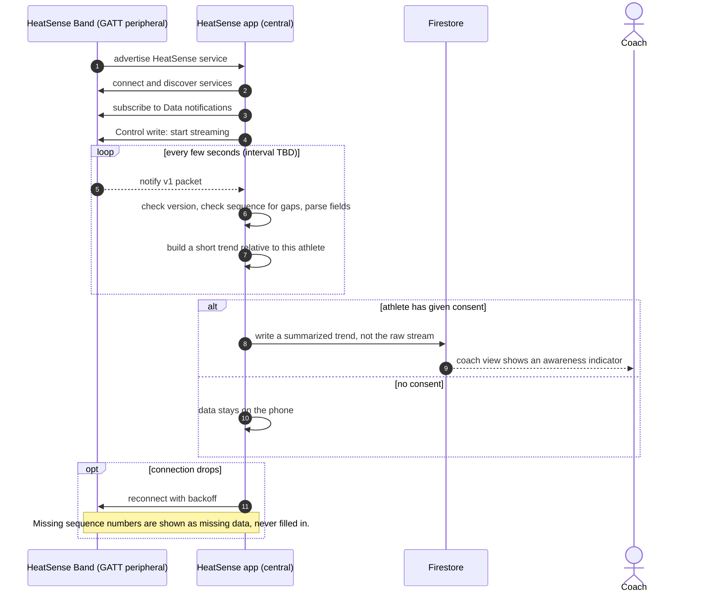
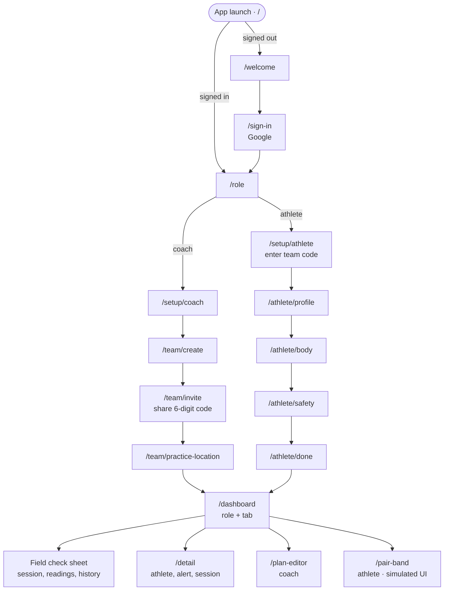

<p align="center">
  
</p>

<p align="center">
  
  
  
  
  <a href="LICENSE"></a>
</p>

<p align="center">
  <b>Congressional App Challenge 2026 · Texas District 4 (TX04)</b>
</p>

<p align="center">
  <a href="#why-this-matters">Why</a> ·
  <a href="#how-it-works">How it works</a> ·
  <a href="#architecture">Architecture</a> ·
  <a href="#team-invites">Team invites</a> ·
  <a href="#data-model">Data model</a> ·
  <a href="#heatsense-band-hardware-in-development">Band</a> ·
  <a href="#screen-map">Screens</a> ·
  <a href="#repository-map">Repo map</a> ·
  <a href="#getting-started">Run it</a> ·
  <a href="#roadmap">Roadmap</a>
</p>

# HeatSense

**HeatSense helps Texas school coaches turn a field WBGT reading into a clear practice plan, follow through on it, and keep a record.**

## Why this matters

Every August, Texas high school teams start practicing in some of the hottest conditions in the country. Starting **August 1, 2026**, the University Interscholastic League (UIL) made WBGT (wet-bulb globe temperature) protocols *required* for outdoor athletics and marching band. Schools now have to check WBGT within 15 minutes before practice, take more readings every 30 minutes under the conditions the plan lists, and change practice using UIL's activity chart. UIL also recommends writing the readings down. ([UIL 2026–27 heat stress plan](https://www.uiltexas.org/health/info/heat-stress-and-athletic-participation))

That is a lot to keep track of from the sideline with a clipboard. UIL's FAQ also says that schools near a Class 2/3 boundary should pick one class and use it all year, and that staff should look at trends, how long practice has been going, recovery, and how each athlete is doing, not only the latest number. ([UIL FAQ](https://www.uiltexas.org/health/info/heat-stress-and-athletic-participationWBGTs))

We built HeatSense so a coach can enter the reading, see what UIL says to do about it, and know when the next check is due. Everyone on the team works from the same record.

> [!IMPORTANT]
> HeatSense is **not a medical device** and does not diagnose heat illness. It helps staff follow their school's heat policy. A qualified adult always makes the call, following the school's emergency action plan.

## Who it's for

| | Who | What they need from HeatSense |
|---|---|---|
| 🧢 | **Coaches** | One screen that answers "can we practice, and how?", plus a reminder when the next reading is due. Coaches run field checks, create a team, and invite athletes. |
| 🩺 | **Athletic trainers** | The same reading and plan the coach sees, plus a record of what was decided. A trainer workspace exists in the dashboard prototype. |
| 🏃 | **Athletes** | Join their team with a code, set up a profile, and follow the team's practice session once approved. Health answers stay private to the athlete (see [Privacy & safety](#privacy--safety)). |

## Status at a glance

We want to be clear about what is real and what is not yet.

| | Feature | Notes |
|---|---|---|
| 🟢 **Works today** | Field check: WBGT reading → UIL zone → guidance → acknowledge → recheck → history → share | See [How it works](#how-it-works). The readings are entered by hand |
| 🟢 **Works today** | Firestore rules recompute the UIL zone and keep readings append-only | `firebase/firestore.rules`. 45/45 emulator tests pass (`npm run test:invites`) |
| 🟢 **Works today** | Google sign-in through Firebase Auth (iOS, web) | Android sign-in still needs release setup and device testing ([auth setup](docs/engineering/auth-setup.md)) |
| 🟢 **Works today** | Coach creates a team and gets a six-digit invite code; athlete joins; coach approves | Cloud Functions in `functions/src/index.ts` |
| 🟢 **Works today** | Athlete profile onboarding (profile → body → safety) | Profile saved to Firestore; health and contact answers are **not** saved in production yet |
| 🟡 **In progress** | iOS Live Activity / Dynamic Island practice widget | Built, but it still shows the built-in **sample** reading |
| 🟡 **In progress** | Dashboard overview | Its hero reading is still the sample from `src/lib/practice.ts`. Real readings live in the field check |
| 🔵 **Planned** | Custom (non-UIL) school heat policies | `src/lib/heat-policy.ts` has `CONFIGURED_POLICY = null` |
| 🔵 **Planned** | Live sensor or weather-based WBGT | Today, every reading is typed in by a coach |
| 🛠️ **In development** | HeatSense Band wearable | Pairing screen UI only. No firmware or Bluetooth code yet. See [HeatSense Band](#heatsense-band-hardware-in-development) |

## How it works

> [!NOTE]
> **Built.** This is the core loop of the app. It lives in `src/components/field-check-sheet.tsx`, `src/lib/uil-wbgt.ts`, and `src/services/practice-sessions.ts`.



Step by step:

1. **Start a session.** The coach picks the venue, the school's UIL class (2 or 3), and how often to recheck (5–120 minutes).
2. **Enter a reading.** The coach enters the WBGT value in °F or °C, where it came from (handheld meter, weather station, or other), and when it was measured. °C is converted and rounded to 0.1 °F, the precision the UIL chart uses.
3. **See the zone and the guidance.** `classifyWbgt()` in `src/lib/uil-wbgt.ts` places the reading in a zone, and the screen shows what the UIL chart says for that zone.
4. **Acknowledge.** The coach confirms they've seen the guidance. The acknowledgment is saved with who did it and when.
5. **Recheck.** A countdown shows when the next reading is due and switches to an overdue state if it's missed.
6. **History.** Every reading stays in the session, shown with how it changed from the one before. Nothing is overwritten or deleted.
7. **Share.** The coach can share a plain-text record of the session. Late readings are marked in it.

Some decisions we made on purpose:

- **The server checks the math.** The app computes the zone, but `firebase/firestore.rules` has its own copy of the UIL thresholds. It recomputes the zone from `wbgtF` and the session's class, and rejects any reading whose zone doesn't match.
- **Readings are append-only.** Once saved, a reading can't be edited or deleted. The only allowed change is the coach's one-time acknowledgment. Sessions can only be ended, never edited.
- **Every reading records its source.** Each session stores the policy version (`uil-wbgt@2025-26`). Each reading stores the entered value and unit, the source, the time measured, and who recorded it.
- **Tested both ways.** `scripts/check-uil-wbgt.ts` checks the classifier against the chart, including the zone boundaries. The emulator suite (`npm run test:invites`, 45/45 passing) covers invites, access rules, and session/reading rules.

## Architecture



Team, invite, and membership documents can only be written by Cloud Functions, which check who is calling. The client writes three things directly, and the security rules check each one field by field: the athlete's own profile, practice sessions and readings (coach only), and, on emulators only, the athlete's private health and safety answers.

## Team invites

A team invite is only a six-digit code, so we treated it as something people might try to guess.



What the code in `functions/src/index.ts` actually does:

- **Codes are never stored in plain text.** Lookups use an HMAC keyed with `INVITE_CODE_SECRET`, so nobody can precompute all 1,000,000 codes from the database. The coach's own code is stored AES-256-GCM encrypted so it can be shown again without rotating it.
- **Codes expire after 7 days** and can be revoked. A revoked code loses its index entry and reads as "not found."
- **No two active teams share a code.** `inviteCodeIndex` acts as a uniqueness lock inside a transaction, and the server retries if two codes collide.
- **Guessing is rate-limited.** After 5 misses per account or 20 per hashed IP within 10 minutes, the caller is locked out. Each lockout doubles the next one (10 min → 20 → 40 … up to 24 hours).
- **A code alone never grants access.** Joining creates a *pending* membership, and only the coach's approval makes it active.
- App Check enforcement is built in but currently **off** (`ENFORCE_APP_CHECK = false`) until the app registers a provider.

## Data model

These are the collections defined in `firebase/firestore.rules` and `functions/src/index.ts`.



| Collection | Who can read it from the app | Who can write it |
|---|---|---|
| `teams` | The coach, and approved (active) members | Cloud Functions only |
| `teams/{id}/sessions` | The coach, and approved members | Coach creates; coach can only set `endedAt` once; no deletes |
| `teams/{id}/sessions/{id}/readings` | The coach, and approved members | Coach adds to an open session; zone must match the rules' own UIL calculation; only a one-time acknowledgment afterward; no edits or deletes |
| `teamMembers` | The athlete themselves, and the team's coach | Cloud Functions only |
| `teamInvites`, `inviteCodeIndex`, `coachTeams`, `rateLimits` | Nobody | Cloud Functions only |
| `athletes/{uid}` | The athlete, and their coach once the athlete is approved | The athlete (every field validated) |
| `athletes/{uid}/private/*` | The athlete only, never the coach | The athlete only (production storage is off for now) |

## UIL WBGT zones

HeatSense uses the same five zones as UIL: green, yellow, orange, red, and black. The numbers below come from the official UIL chart, and the same values appear in `src/lib/uil-wbgt.ts` and `firebase/firestore.rules`. ([UIL 2025–26 WBGT chart](https://www.uiltexas.org/files/athletics/25-26WBGTChart.png))

> [!NOTE]
> These values are **WBGT**, not air temperature or heat index. A 90°F afternoon is not the same as a 90°F WBGT reading.



| Zone | Class 3 WBGT (°F) | Class 2 WBGT (°F) | What the UIL chart says to change |
|---|---|---|---|
| 🟢 Green | below 82.0 | below 79.7 | Normal activities. At least 3 rest breaks per hour, each at least 3 minutes. |
| 🟡 Yellow | 82.0–86.9 | 79.7–84.6 | Use discretion for intense or long exercise. At least 3 breaks per hour, each at least 4 minutes. An on-site rapid cooling zone (tub or tarp) is required. |
| 🟠 Orange | 87.0–90.0 | 84.7–87.6 | Practice limited to 2 hours. Football: helmet, shoulder pads, and shorts only. At least 4 breaks per hour, each at least 4 minutes. Cooling zone required. |
| 🔴 Red | 90.1–92.0 | 87.7–89.7 | Practice limited to 1 hour. Football: no protective equipment and no conditioning. 20 minutes of rest per hour. Cooling zone required. |
| ⚫ Black | 92.1 and up | 89.8 and up | No outdoor workouts. Wait until it is cooler. |

This table is a summary to help explain the app. A school should always follow the full UIL plan and its own heat policy. A school's WBGT class depends on where the school is, not on its congressional district. Schools near a boundary choose one class and keep it for the whole year (UIL FAQ).

> [!NOTE]
> **A bug we fixed:** older sample data labeled 84°F WBGT as **orange**. On the UIL chart, 84°F is **yellow** for both classes. The sample zone in `src/lib/practice.ts` is now computed by the same classifier, and `scripts/check-uil-wbgt.ts` tests this case.

## HeatSense Band (hardware, in development)

> [!WARNING]
> **In development.** Right now the band is a design and a parts list. **The repository contains no firmware and no Bluetooth code, and no BLE library is installed.** `src/app/pair-band.tsx` is a pairing screen whose search and pairing are *simulated* with short delays. Nothing below has been built or tested. The band does not and will not diagnose heat illness. Its signals are only meant to give a coach or athletic trainer extra awareness, alongside WBGT, which stays the primary input.

The HeatSense Band is a screenless wearable that an athlete wears on the wrist or upper arm, similar in shape to a WHOOP strap. It pairs with the HeatSense app. It would add a little individual context (pulse, movement load, and skin conductance) to the team-wide WBGT picture.

### What exists today vs. what's planned

| | Item |
|---|---|
| ✅ Exists | Pairing screen UI (`src/app/pair-band.tsx`), simulated, reached from the athlete dashboard |
| ✅ Exists | The band as an optional part of the product design. The app is fully usable without it |
| 🔵 Planned | Firmware for the ESP32 Nano (C++, Arduino framework, built with PlatformIO) |
| 🔵 Planned | A BLE library in the app, for example `react-native-ble-plx` (needs a native build, not Expo Go) |
| 🔵 Planned | The GATT service and packet format below, then versioning them |
| 🔵 Planned | Bench testing each sensor on its own, then on-body testing against a reference device |
| 🔵 Planned | A consent flow before any band data leaves the athlete's phone |

### Bill of materials

| Part | Role on the band | Interface |
|---|---|---|
| **ESP32 Nano** board | Microcontroller. Reads the sensors, builds packets, and runs the BLE radio | n/a, it is the host |
| **MAX30102** | Optical pulse sensor (PPG). Gives heart rate | I2C (default address 0x57) |
| **MPU6050** | 6-axis accelerometer + gyroscope. Gives movement and activity load | I2C (default address 0x68) |
| **GSR sensor** | Galvanic skin response (skin conductance). Used as a sweat-response trend | Analog voltage → ESP32 ADC pin |
| **LiPo battery** | Power | → charging module |
| **LiPo charging module** | Charges the battery safely and feeds the board | Battery in/out → board power input |

The two digital sensors have different I2C addresses, so they share one bus (SDA/SCL). The GSR sensor outputs an analog voltage, so it uses an ADC pin instead.

### Block and wiring diagram



### Languages and tools

| Side | Language | Tools | Status |
|---|---|---|---|
| Band firmware | C++ | Arduino framework on ESP32, built with PlatformIO | Planned, no code yet |
| App | TypeScript | React Native / Expo, plus a BLE library such as `react-native-ble-plx` | Pairing UI exists; BLE layer planned |

### Bluetooth Low Energy design (draft)

- **Roles:** the band is the **GATT peripheral** and advertises the HeatSense service. The phone is the **central**: it scans, connects, and subscribes.
- **One custom HeatSense service** (128-bit UUID, not assigned yet) with two characteristics:
  - **Data**: *notify*. The band pushes one small binary packet on a regular interval.
  - **Control**: *write*. The app sends simple commands, for example start/stop streaming, set the interval, or ask for the battery level.
- **Packets are binary and versioned**, so the app can reject or adapt to formats it doesn't understand, and the firmware can change without breaking older app builds.

**Draft packet schema (v1)**: little-endian, 13 bytes, which fits in one default-size BLE notification.

| Offset | Field | Type | Meaning |
|---|---|---|---|
| 0 | `version` | uint8 | Packet format version (1) |
| 1 | `sequence` | uint16 | Counts up by one per packet and wraps around. Gaps show dropped packets |
| 3 | `timestamp` | uint32 | Seconds since the band started (the app maps this to wall-clock time) |
| 7 | `heartRate` | uint8 | Beats per minute, 0 = no valid reading |
| 8 | `motion` | uint16 | Movement magnitude from the MPU6050 (units TBD) |
| 10 | `gsr` | uint16 | Raw GSR level from the ADC (relative trend, not calibrated) |
| 12 | `battery` | uint8 | Battery percent, 0–100 |

> This schema is a **draft**. Field sizes, units, and the interval will change once we test real hardware.

### Data flow (planned)



### Design goals for connection problems

- **Reconnect automatically** with increasing delays, without the athlete doing anything.
- **Never fake data.** Gaps in `sequence` are shown as gaps. A missing reading is never filled in or guessed.
- **Show staleness clearly.** If no packet has arrived recently, the app says "no recent band data" instead of showing an old number as current.
- **The app keeps working without the band.** WBGT checks, guidance, and history work the same whether or not a band is paired.
- **Battery awareness.** Warn the athlete when the battery is low, before a practice, not during one.

## Screen map

Routes come from `src/app/` (Expo Router, file-based).



The field check opens as a sheet over the dashboard, not as its own route. `/ready` (role-specific setup after the intro screens) and the redirect shims `/setup/[role]` and `/team/[mode]` also lead to `/dashboard`.

## Screenshots

<!-- UPDATE AFTER BUILD -->
| Welcome | Sign in | Coach dashboard | Team invite |
|---|---|---|---|
| <!-- screenshot: welcome --> | <!-- screenshot: sign-in --> | <!-- screenshot: coach-dashboard --> | <!-- screenshot: team-invite --> |

| Field check | Athlete onboarding | Live Activity | Session history |
|---|---|---|---|
| <!-- screenshot: field-check --> | <!-- screenshot: athlete-onboarding --> | <!-- screenshot: live-activity --> | <!-- screenshot: session-history --> |

## Repository map

```text
heatsense/
├── package.json                 Dependencies and npm scripts. npm requires it at the root
├── app.json                     Expo app config (name, icons, plugins, iOS/Android settings). Expo reads it from the root
├── tsconfig.json                TypeScript settings and the @/ path alias. Editors and tsc look for it at the root
├── eslint.config.js             ESLint flat config (eslint-config-expo). ESLint finds it at the root
├── firebase.json                Firebase CLI config: emulators, functions, and where the rules live. The CLI requires it at the root
├── .firebaserc                  Which Firebase project the CLI deploys to. Lives next to firebase.json
├── .env.example                 Template for local Firebase / Google sign-in settings
├── LICENSE                      MIT license
│
├── src/                         The app (TypeScript / React Native)
│   ├── app/                     Expo Router screens: each file is a route
│   │   ├── _layout.tsx          Root layout: fonts, providers, navigation stack
│   │   ├── index.tsx            Launch: intro steps, or redirect to /welcome or /role
│   │   ├── welcome.tsx          First screen for signed-out users
│   │   ├── sign-in.tsx          Google sign-in
│   │   ├── role.tsx             Pick coach or athlete
│   │   ├── ready.tsx            Role-specific setup after the intro
│   │   ├── setup/               coach.tsx, athlete.tsx (join with a code), [role].tsx (redirect shim)
│   │   ├── team/                create.tsx, invite.tsx (show/share code), practice-location.tsx, [mode].tsx (redirect)
│   │   ├── athlete/             Athlete onboarding: profile → body → safety → done
│   │   ├── dashboard.tsx        Tabbed workspace for each role
│   │   ├── detail.tsx           Drill-downs: athlete, alert, session
│   │   ├── plan-editor.tsx      Coach practice-plan editor
│   │   └── pair-band.tsx        HeatSense Band pairing screen (UI only, pairing is simulated)
│   ├── components/              UI building blocks
│   │   ├── field-check-sheet.tsx  Core loop: reading → guidance → acknowledge → recheck → history → share
│   │   ├── dashboard-*.tsx      Dashboard shell, role content, and empty/offline/alert states
│   │   ├── coach/               Coach workspace, WBGT gauge, recheck clock
│   │   ├── ui/                  Shared lists, charts, buttons, visuals
│   │   └── onboarding-*.tsx     Onboarding visuals, fields, and controls
│   ├── lib/                     Pure logic with no UI
│   │   ├── uil-wbgt.ts          UIL WBGT classifier: thresholds, guidance, °C→°F, zone ranges
│   │   ├── heat-policy.ts       Policy types for custom school policies (none configured yet)
│   │   ├── practice.ts          Zone colors and the built-in sample reading
│   │   └── practice-activity.ts Starts and updates the iOS Live Activity
│   ├── services/                Talking to Firebase
│   │   ├── firebase.ts          Firebase app, Auth, Firestore, Functions (and emulator hookup)
│   │   ├── google-auth.ts       Native Google sign-in (.web.ts for the browser)
│   │   ├── practice-sessions.ts Firestore sessions + append-only readings, recheck status, text report
│   │   ├── team-invites.ts      Calls the invite Cloud Functions; watches memberships
│   │   ├── team-roster.ts       Reads the team's members
│   │   └── athlete-*.ts         Athlete profile, health, and safety data (health storage off in production)
│   ├── state/                   App state: auth session, onboarding, preferences, practice day and plans
│   ├── hooks/                   use-coach-team, use-roster
│   ├── constants/               Theme, colors, type scale, sports list, dev flags
│   ├── widgets/                 PracticeActivity.tsx: iOS Live Activity / Dynamic Island layout
│   └── types/                   Small type declarations
│
├── functions/                   Firebase Cloud Functions (TypeScript, Node)
│   └── src/index.ts             Team invites: create team, issue/rotate codes, look up, request to join, approve
│
├── firebase/                    Firebase rules (referenced from firebase.json)
│   ├── firestore.rules          Security rules, including the server-side UIL zone check
│   └── firestore.indexes.json   Firestore index definitions
│
├── scripts/                     Developer scripts
│   ├── check-uil-wbgt.ts        Self-check for the UIL classifier (node scripts/check-uil-wbgt.ts)
│   ├── test-team-invites.mjs    Emulator test suite: invites, access rules, sessions, readings
│   ├── check-auth-config.mjs    Checks Google sign-in configuration (npm run check:auth)
│   ├── check-coach-countdown.mjs Checks the recheck countdown math
│   ├── capture-screen.sh        Screenshot one route on the iOS Simulator
│   ├── capture-manifest.mjs     Screenshot every route in design/screen-manifest.json
│   └── reset-project.js         Expo starter reset script
│
├── docs/
│   ├── research/                cac-tx04-research-2026.md: contest rules, UIL research, build plan
│   ├── design/                  Design system, reference map, character direction, component inventory, UI product contract
│   ├── engineering/             auth-setup.md: Firebase + Google sign-in setup
│   ├── archive/                 Older notes: session handoff (2026-09-15), entry UI review
│   └── screenshots/             Saved screenshots for review
│
├── design/                      design-tokens.json and screen-manifest.json (route → screenshot list)
├── assets/                      App icons, images, concept art, README art, band render
├── ios/                         Native iOS project generated by Expo (includes the widget target)
├── public/                      Web assets (Skia's web build is copied here on install)
└── .github/workflows/           auth-preflight.yml: CI check for sign-in configuration
```

## Tech stack

| Layer | What we use |
|---|---|
| App framework | [Expo](https://expo.dev/) SDK 57, React Native 0.86, React 19.2, TypeScript 6 |
| Navigation | [Expo Router](https://docs.expo.dev/router/introduction/) (file-based routes, typed routes) |
| Auth | Firebase Auth with Google sign-in (`@react-native-google-signin/google-signin` on native) |
| Database | Cloud Firestore with field-level validation and a server-side UIL zone check in security rules |
| Backend | Firebase Cloud Functions v2 (callable functions, Node `crypto` for HMAC / AES-GCM) |
| iOS extras | Live Activity / Dynamic Island widget via `expo-widgets` |
| Location | `expo-location` and `expo-maps` for the team's practice location |
| UI & motion | React Native Reanimated 4 (with Reduce Motion support), Skia, React Native SVG, Gifted Charts, Atkinson Hyperlegible Next |
| Testing | Firebase emulators + `scripts/test-team-invites.mjs`; `scripts/check-uil-wbgt.ts` |
| Band (planned) | C++ on ESP32 with the Arduino framework and PlatformIO; a BLE library such as `react-native-ble-plx` in the app |

## Getting started

**You need:** Node.js 22.13 or newer, npm, and Xcode with an iOS Simulator (or Android Studio, or just a browser for web).

```bash
git clone https://github.com/s-k-28/heatsense.git
cd heatsense
npm install
```

Copy `.env.example` to `.env` and fill in your Firebase project values. [docs/engineering/auth-setup.md](docs/engineering/auth-setup.md) walks through Google sign-in setup.

```bash
npm run ios        # build and run on the iOS Simulator
npm run android    # build and run on an Android emulator
npm run web        # run in the browser
```

### Run the backend locally

```bash
npm run emulators     # builds functions, starts Auth + Firestore + Functions emulators
npm run test:invites  # runs the emulator test suite (invites, access rules, sessions, readings)
```

The invite functions need an `INVITE_CODE_SECRET` of at least 32 characters, or they refuse to issue codes.

### Checks before pushing

```bash
npx tsc --noEmit
npm run lint
node scripts/check-uil-wbgt.ts
npm run test:invites
```

## Privacy & safety

- **Not a medical device.** HeatSense helps staff follow their school's heat policy. It does not diagnose anyone, and a qualified adult always makes the decision.
- **Health data is not saved in production.** We don't have a parent/guardian consent flow or a published privacy notice yet, and many athletes are minors. Because of that, `HEALTH_STORAGE_APPROVED = false` in `src/services/athlete-health.ts`, and health and emergency-contact answers stay in memory for the session only. Storage only runs against the local emulators so we can test the rules. (This is a client flag; we still need to enforce it on the server too.)
- **Coaches can't see health answers.** Even when storage is on, `athletes/{uid}/private/*` can be read only by the athlete. The rules enforce this, not just the UI.
- **Readings can't be quietly changed.** Field readings are append-only, and the server checks every zone.
- **Band data will need consent first.** Under the planned design, band data stays on the athlete's phone unless they consent, and even then only a summary is shared.
- **Rate-limit records store a hash of the IP address**, never the raw address.

## Roadmap

**Contest build**
- [x] Manual WBGT entry with units, source, and measurement time
- [x] UIL class selection, with the policy version saved on each session
- [x] Zone and guidance from a deterministic, tested classifier (`src/lib/uil-wbgt.ts`)
- [x] Server-side zone check and append-only readings in Firestore rules
- [x] Coach acknowledgment, recheck countdown, and overdue state
- [x] Session history synced to the team through Firestore, with a shareable text record
- [ ] Replace the sample reading in the dashboard overview and Live Activity with the session's latest reading <!-- UPDATE AFTER BUILD -->
- [ ] Have a local coach or athletic trainer review how we interpret the UIL chart

**Next**
- [ ] Weather-based WBGT estimates as a second, clearly labeled source
- [ ] Parent/guardian consent flow and privacy notice, then turn health storage on
- [ ] Android release setup and testing on real devices
- [ ] App Check enforcement for the invite functions

**HeatSense Band: in development**
- [ ] Bench-test each sensor (MAX30102, MPU6050, GSR) on the ESP32 Nano
- [ ] Firmware v0: read sensors, build v1 packets, BLE notify
- [ ] App BLE layer: scan, pair, subscribe, parse, reconnect
- [ ] Consent flow before any band data is shared
- [ ] On-body testing against a reference heart-rate device

## Team

<!-- TEAM: fill in -->
| Name | Role | What they built |
|---|---|---|
| <!-- TEAM: fill in --> | | |

### AI-use disclosure

The 2026 Congressional App Challenge rules allow AI tools if teams fully disclose how they used them, make significant contributions themselves, and understand the technology.

<!-- TEAM: fill in — which AI tools were used, for what parts (code, design, docs, this README), and what the team wrote, reviewed, and tested themselves. -->

## More docs

- [CAC TX04 research and submission plan](docs/research/cac-tx04-research-2026.md)
- [UI product contract](docs/design/ui-product-contract.md)
- [Design system](docs/design/design-system.md)
- [Design reference map](docs/design/design-reference-map.md)
- [Firebase and Google sign-in setup](docs/engineering/auth-setup.md)
- [Session handoff, September 15, 2026 (archived)](docs/archive/agent-session-handoff-2026-09-15.md)

## License

[MIT](LICENSE)
