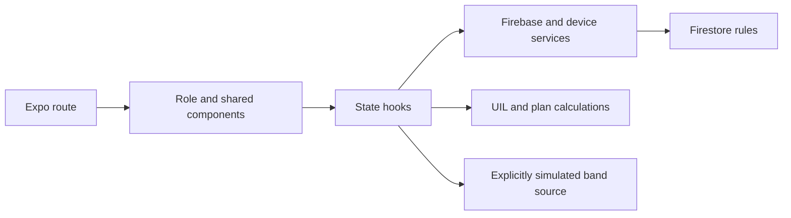

# Architecture

HeatSense is an Expo Router application with three role dashboards. Firebase Authentication identifies the user; Firestore rules control access to teams, practice records and private athlete data. The app does not deploy a custom application server.

## Source boundaries

| Directory | Responsibility |
| --- | --- |
| `src/app` | File-based routes, navigation parameters and screen assembly. Moving these files changes URLs, so UI organization does not move routes. |
| `src/components/dashboard/coach` | Coach Home, Plan, the restored Team tab and Alerts. |
| `src/components/dashboard/athlete` | Athlete Home/Band/Sessions and Learn. |
| `src/components/dashboard/trainer` | Trainer Home, Monitor, Athletes and Protocols. |
| `src/components/dashboard` | Role/tab composition, shared Profile, scrolling, preview states and the team-share action. |
| `src/components/practice` | Shared field-check sheet, field hero, readings timeline, heat calendar and orb/rings. |
| `src/components/band` | Band artwork, angle viewer, onboarding journey and signal analyses. |
| `src/components/onboarding` | Shared entry layout, fields, choices and introductory visuals. |
| `src/components/branding`, `layout`, `motion`, `ui` | Reusable presentation primitives. `ui/data-display.tsx` holds the shared rows, facts and metric summaries. |
| `src/constants` | Brand palette, typography and shared configuration values. |
| `src/lib` | UIL calculations, plan checks, simulation, motion and Live Activity helpers. Pure calculation modules remain independent of React Native. |
| `src/services` | Firebase/device integration and data contracts. Platform variants such as `google-auth.web.ts` remain paired with their native implementation. |
| `src/state` | Auth/session adapters, onboarding, preferences, plans and band uplink state. |
| `src/widgets` | The native iOS Live Activity entry. |

Use direct imports through `@/`; avoid broad barrel exports that hide dependencies or create cycles. Keep shared UI in `components/ui`, and put role-specific composition with that role.

## Data and UI flow

The practice loop is reading → classified zone → guidance → acknowledgment → recheck → saved record. Cleanup must preserve its thresholds, measurements, data sources and access rules. Visualizations and animation behavior are shared across the same components as before the reorganization.

`dashboard/preview-field-card.tsx` contains the existing static field preview used by explicit preview states. It is separate from normal dashboard composition so its sample values are not mistaken for production measurement logic.

## Configuration and artifacts

- Root `app.json`, `package.json`, `tsconfig.json`, `eslint.config.js`, `firebase.json` and `.firebaserc` are tool-discovered configuration.
- `firebase/` owns rules and indexes. `public/vercel.json` owns static web hosting configuration.
- `assets/` contains runtime artwork and licenses. Exploratory artwork lives in `docs/design/concepts/`.
- `docs/design/manifests/` contains design export data and the screenshot route manifest; these are not runtime theme tokens.
- Build output, emulator logs, node_modules, private environment files and local session history are not source artifacts.

See [development](development.md) for environment modes and [maintenance](repository-maintenance.md) for cleanup verification and intentionally retained capabilities.
