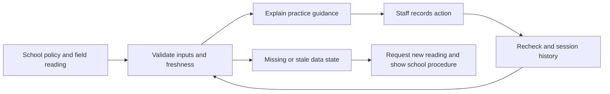

# HeatSense: research and submission strategy for TX04

Research date: October 18, 2026. Initial local audit: `47d184b`; updated against GitHub `main` at `dbc3055` before publication.

## Recommendation

Build the contest entry around one complete, demonstrable job:

**HeatSense helps Texas school staff turn a field WBGT reading into a clear practice plan, follow through on that plan, and keep a record.**

The most persuasive submission would combine a functioning practice workflow, a documented review by a local coach or athletic trainer, and a student explanation of the policy engine and its failure handling. These are recommendations, not predictions of the judges' decision.

Keep the optional wristband as a separately labeled research direction unless hardware and validation actually exist. The current repository supports a polished prototype and real authentication; it does not yet support claims of a deployed team safety system or validated physiological detection.

## 1. TX04 contest facts and immediate decisions

TX04, represented by Pat Fallon, is listed as participating in 2026. This is a district competition: participating offices select district winners. Registration for this particular team has not been verified. [Participating districts](https://www.congressionalappchallenge.us/students/participating-districts/), [district winner structure](https://www.congressionalappchallenge.us/25-tx04/).

### The deadline has conflicting official times

| Official source | Published October 26, 2026 cutoff | Chicago equivalent |
|---|---|---|
| [2026 rules, section 5](https://www.congressionalappchallenge.us/wp-content/uploads/2026/05/2026-CAC-Rules.pdf) | Noon EDT | 11 a.m. CDT |
| [Fallon's TX04 page](https://fallon.house.gov/services/congressional-app-challenge.htm) | 8 p.m. ET | 7 p.m. CDT |
| [National student registration](https://www.congressionalappchallenge.us/students/student-registration/) | 9 p.m. ET | 8 p.m. CDT |

**Internal target: submit October 23 and verify the receipt. Treat 11 a.m. Chicago time October 26 as the earliest published cutoff until the office resolves the discrepancy.** The office publishes `TX04AppChallenge@mail.house.gov` for questions. No message has been sent. Registration and the eligibility quiz should be completed immediately if still outstanding.

### Rules that affect this project

The 2026 rules require middle/high-school enrollment, an eligible home or school district, at most four teammates, and at least half the team qualifying in the same district. One entry per student; work must date after October 30, 2025, with new coding distinguished for a 2.0 entry. AI use is allowed with full disclosure, significant student contributions, and technical understanding. The video must be 1–3 minutes and public on YouTube or Vimeo. Judges may request the working app and code. [2026 rules](https://www.congressionalappchallenge.us/wp-content/uploads/2026/05/2026-CAC-Rules.pdf).

The published selection criteria cover idea quality, implementation/design, and programming skill. The office retains discretion; no TX04-specific weighting was located. [2026 rules](https://www.congressionalappchallenge.us/wp-content/uploads/2026/05/2026-CAC-Rules.pdf).

The national judges page links an older **2021 example rubric**, with concept and technology categories totaling 30 points. It rewards relevance, impact explanation, presentation, function, code understanding, and UI. Use those dimensions to review our entry; do not claim this is TX04's confirmed 2026 scoring sheet. [Judges page](https://www.congressionalappchallenge.us/get-involved/judges/), [example rubric](https://www.congressionalappchallenge.us/wp-content/uploads/2022/09/CAC-Judging-Rubric.pdf).

## 2. What the app actually does today

This is a source audit, not a fresh runtime test of every route. Prior authentication verification is documented in the repository. Newer remote commits add a real invitation backend and a rebuilt dashboard; older documentation has not fully caught up.

| Area | Evidence | Assessment |
|---|---|---|
| Product purpose | [Product contract](../design/ui-product-contract.md), [README](../../README.md) | WBGT is primary; wristband is optional. The README describes 33 deterministic review routes. |
| Google sign-in | [Native service](../../src/services/google-auth.ts), [web service](../../src/services/google-auth.web.ts), [Firebase setup](../../src/services/firebase.ts), [auth verification](../engineering/auth-setup.md) | Real Firebase credential exchange and persistence; earlier iOS/web walkthroughs recorded. This does not establish every account, device, and future release will work. |
| Android | [Auth setup](../engineering/auth-setup.md) | Package/certificate registration and device verification remain release gaps. Do not advertise tested Android parity. |
| Teams and invitations | [Invite service](../../src/services/team-invites.ts), [Firestore rules](../../firebase/firestore.rules) | The newer implementation uses server-generated six-digit codes, expiry/revocation, rate limits, pending membership, and coach approval. Deployment and cross-device behavior were not reverified in this research pass. |
| Backend verification assets | [Emulator tests](../../scripts/test-team-invites.mjs) | Tests cover invitations and access boundaries. Test code exists; this report does not claim a new passing run. |
| Athlete onboarding | [Health service](../../src/services/athlete-health.ts), [safety service](../../src/services/athlete-safety.ts) | Profile/body/safety flows exist. Production health/contact persistence is disabled by client flags pending consent/privacy work; emulator paths can exercise storage. These flags do not themselves enforce a server-side collection prohibition. |
| Reading and plan | [Practice fixture](../../src/lib/practice.ts), [dashboard content](../../src/components/dashboard-content.tsx) | Hard-coded `84`, `orange`, `20 / 10`, and sample roster remain in the active dashboard. No policy classification function in that data source. |
| Dashboard freshness | [Dashboard screen](../../src/app/dashboard.tsx), [preferences](../../src/state/preferences.ts) | Pull-to-refresh waits 900 ms and sets a local timestamp; the reading stays a fixture. The hero then says “updated just now.” This is UI refresh, not a new measurement. |
| Practice activity | [Live Activity controller](../../src/lib/practice-activity.ts), [widget](../../src/widgets/PracticeActivity.tsx) | iOS activity support is implemented with the shared sample reading. Session start is module-local `Date.now()`, rather than a persisted practice record. |
| Earlier recheck calculation | [Recheck clock](../../src/components/coach/recheck-clock.ts) | Useful absolute-time calculation and overdue state, but the current dashboard follows the newer activity path. Reuse the principle, not an assumption that the entire workflow is complete. |
| Weather and wristband | [README roadmap](../../README.md), [product contract](../design/ui-product-contract.md) | Live integration, firmware, and validated sensor pipeline remain future work in the reviewed scope. |

### A concrete mismatch to fix first

Both the old coach fixture and the newer shared practice fixture assign **84°F WBGT to Orange**. The chart linked by the current UIL plan places that reading in **Yellow for both Class 2 and Class 3**. The existing `20 / 10` plan is illustrative and should not be presented as the UIL rule. The design contract currently preserves the example, so the contract, dashboard, and Live Activity need to change together. [UIL chart](https://www.uiltexas.org/files/athletics/25-26WBGTChart.png).

**Second priority: preserve measurement truth.** The current hero's “updated just now” text can be triggered without obtaining a new reading. Store measurement time separately from screen refresh time, and clearly label the dashboard and Live Activity as demonstration data until connected. The older coach workspace has sample labels; the rebuilt hero needs an equally explicit label.

Also review athlete labels such as “Normal” and “Signals within baseline”: neither establishes that an athlete is medically safe. Separate environmental category, data availability, and human review status in the UI.

## 3. Why this is timely in Texas

UIL's WBGT protocols became required August 1, 2026 for outdoor athletics and marching band. The plan calls for a pre-practice check within 15 minutes, subsequent readings every 30 minutes under the specified monitoring conditions, and modifications using its activity chart. It permits scientifically supported instruments or other proven methods, including suitable internet-based sources. Recording readings is recommended. Practice restrictions and contest provisions differ; rapid-cooling requirements also apply to contests. [UIL 2026–27 plan](https://www.uiltexas.org/health/info/heat-stress-and-athletic-participation).

The FAQ adds two important implementation details: schools near a Class 2/3 boundary should make a local selection and apply it consistently through the year; staff should consider conditions, trends, elapsed practice, recovery, and participant status when responding to changing readings. A congressional district number does not determine a school's WBGT class. [UIL FAQ](https://www.uiltexas.org/health/info/heat-stress-and-athletic-participationWBGTs).

**Product implication:** make the school's policy choice explicit and versioned. Offer a brief reason for every recommendation. Keep the staff member's decision and the input that produced it in the same session record. Ask a local athletic trainer to review the interpretation before presenting it as operational guidance.

## 4. Scientific evidence and what it supports

This is a focused evidence review, not a systematic review or clinical validation of HeatSense. Study findings below apply to their tested populations, instruments, and procedures.

| Evidence | Findings and limitations | HeatSense implication |
|---|---|---|
| **Kerr et al., 2019**, quasi-experimental study of high-school football preseason practices | 48 states, 455 state-years, approximately 2.70 million athlete-exposures and 190 reported illnesses. Mandated acclimatization guidelines were associated with lower illness rates: adjusted incidence-rate ratio 0.45, 95% CI 0.23–0.87. Observational policy evidence cannot isolate an app's effect. [Paper](https://pubmed.ncbi.nlm.nih.gov/30969138/), [full text](https://ehp.niehs.nih.gov/doi/pdf/10.1289/EHP4163). | Support adherence to an established plan. Do not claim HeatSense reduces illness by 55%. |
| **Cooper et al., 2020**, Georgia grades 9–12 football | Before/after policy study: 214 heat-syncope/exhaustion cases and 341,348 athlete-exposures. Post-policy rates were lower across categories after combined acclimatization and activity changes. Multiple changes occurred together; this is not a randomized software trial. [Paper](https://pmc.ncbi.nlm.nih.gov/articles/PMC7384466/). | Track practice duration and actions, rather than showing an isolated weather number. |
| **Athletic-surface WBGT comparison, 2017** | 143 paired observations across 10 surfaces over 18 days. Modeled regional readings and onsite readings classified activity categories differently 45% of the time. This particular model and setting do not represent every modern weather provider. [Paper](https://pubmed.ncbi.nlm.nih.gov/29095037/). | Display source, location, timestamp, and whether a value is measured or modeled. Evaluate any chosen provider against local reference readings. |
| **de Korte et al., 2022**, estimated core temperature | 101 elite athletes; heart-rate algorithm compared with ingestible temperature capsules. Accuracy was more useful in low/middle ranges; sensitivity was poor above 39°C, with false negatives. Not validation of a homemade adolescent wristband. [Paper](https://pubmed.ncbi.nlm.nih.gov/35813051/). | Never treat reassuring estimated values as clearance or use this algorithm alone to detect dangerous heat illness. |
| **Verdel et al., 2021**, CORE sensor | Two male cycling cohorts, 12 and 13 participants. About half of paired measurements exceeded the study's 0.3°C agreement criterion versus rectal temperature. Findings concern the studied device/version and conditions, not every later product. [Paper](https://pubmed.ncbi.nlm.nih.gov/34502822/). | A published sensor concept or repeatable measurement is insufficient evidence of field accuracy. |
| **Bent et al., 2020**, optical heart rate | Six devices in 53 participants spanning skin tones. Errors varied by device/activity; activity error averaged 30% higher than rest. This study found no significant accuracy difference by skin tone. [Paper](https://www.nature.com/articles/s41746-020-0226-6), [author manuscript](https://dukespace.lib.duke.edu/server/api/core/bitstreams/06714598-aa7c-450c-b360-67f93ba7132d/content). | Validate the actual hardware during movement and across users. Include signal-quality and missing-data states. |
| **Kulkarni et al., 2020**, EDA dehydration prototype | The arXiv report describes five users and labels based on designed water-intake routines. It is preliminary evidence, not established clinical ground truth for adolescent athletic dehydration. [Preprint](https://arxiv.org/abs/2009.13626). | Label GSR/EDA as an experimental signal; do not display a validated “hydration percentage.” |
| **Casa et al., 2015**, NATA position statement | Clinical recommendations cover prevention, recognition, emergency planning, and treatment; this is guidance, not a trial of an app. Heat illness can occur without extreme environmental conditions. [Position statement](https://www.nata.org/sites/default/files/exertional_heat_illnesses.pdf). | Maintain quick access to the school's emergency plan. A symptom concern must not be dismissed because a dashboard is green. |

### Claims we can and cannot substantiate

After implementation and verification, a defensible claim is: “HeatSense translates a recorded WBGT reading and selected school policy into practice guidance and a session history.”

Claims such as “predicts heat stroke,” “measures core temperature from the wrist,” “detects dehydration,” “prevents deaths,” or “works for all athletes” are not established by this repository or the studies reviewed. A future hardware program needs an appropriate reference measurement, independent evaluation, participant-level validation, uncertainty reporting, and false-negative analysis. That work belongs on a longer research timeline.

## 5. Existing products and prior winners

### Product landscape

These are documented product capabilities, not independent head-to-head tests.

| Product | Existing capability | Opportunity to investigate |
|---|---|---|
| [Perry Weather](https://perryweather.com/features/) | Onsite readings, policy-based alerts, work/rest guidance, mobile access, exports. | Test whether a lightweight session workflow is useful to schools that already have a handheld meter. “WBGT + alerts” is already an established category. |
| [Kestrel 5400](https://kestrelinstruments.com/category-heat-stress/kestrel-5400-heat-stress-tracker), [manufacturer guide](https://kestrelinstruments.com/mwdownloads/download/link/id/14) | Dedicated field instrument; LiNK variants support mobile connectivity. | Manual entry from existing equipment is a practical initial path. Direct pairing requires separate integration work. |
| [WeatherSTEM](https://www.weatherstem.com/heat) | Sensor-derived WBGT, forecasts, notification architecture, a published forecast API. | Possible future data source; review access terms, source semantics, accuracy, and availability before depending on it. |
| [OSHA–NIOSH Heat Safety Tool](https://www.cdc.gov/niosh/heat-stress/communication-resources/app.html) | Occupational heat-index guidance and forecasts. CDC currently notes that the app is not receiving updates. | School-specific WBGT workflows have a different task and audience. Do not equate heat index with WBGT. |

**Differentiation hypothesis:** a clear, accessible, equipment-independent practice record that carries a staff member from reading to action to recheck, with transparent policy reasoning. Local interviews must establish that this solves a real unmet workflow; the research does not prove competitors lack similar features or that schools will adopt ours.

### Relevant CAC winners

| Entry | What its official description establishes | Lesson to test |
|---|---|---|
| [TX04 2025: Piggy Pal](https://www.congressionalappchallenge.us/25-tx04/) — Vedant Dutta and Beckham Speiden | A budgeting app motivated by teenage spending habits, with a tax-calculation component. | Explain a familiar problem and show useful actions. |
| [TX04 2024: Medicable](https://www.congressionalappchallenge.us/24-TX04/) — Vihan Raval | Appointment/prescription and mental-health resource needs rooted in a personal observation. | Ground the story in an authentic experience and specific user need. |
| [TX34 2025: Heatwave](https://www.congressionalappchallenge.us/25-tx34/) — Max Moyle | Pedestrian navigation responding to local heat, shade, and walking conditions. | Heat is already represented among winning entries; make HeatSense's school-practice task explicit. |

These descriptions do not reveal scoring, judge deliberations, or 2026 competitors. They support narrative comparisons, not a formula for winning.

## 6. The smallest strong contest build

Choose one pilot context, preferably a school team with an accessible coach or athletic trainer. Marching band is a relevant expansion, but avoid adding another untested workflow immediately.

### Required working sequence

1. Open a clearly labeled practice or demonstration session.
2. Confirm venue, activity, school policy/class, and policy version.
3. Enter a WBGT value with units, measurement source, and measurement time.
4. See the derived category and specific actions, with a link to the policy source.
5. Record the responsible person's acknowledgment and any contextual decision.
6. Show elapsed practice time and the next recheck; preserve timing through app suspension/restart.
7. Add a second reading; explain what changed without erasing the previous record.
8. Export the session history, including missing/overdue readings and adjustments.

### Technical work worth explaining to judges

- A deterministic, independently testable policy function, separated from visual components.
- Versioned rules and a source record, so historical guidance remains understandable after policy changes.
- Explicit states for missing, stale, invalid, and demonstration readings.
- Absolute timestamps, persisted session events, and a visible overdue state.
- A session export that distinguishes the input, computed recommendation, and actual staff action.

A workable initial version can use manual entry and local storage for practice sessions while retaining the new team backend. Clearly disclose the session scope. Verify the deployed invitation flow across two accounts/devices before making it part of the main demo. Keep actual health answers out of the demonstration and preserve the current collection restrictions until their prerequisites are resolved.

### UI direction

Make the first useful screen answer: **What should I do now? What reading supports it? When do I check again?**

- Give the primary action more prominence than the decorative temperature card.
- Always show “WBGT,” units, source, age, and selected policy near the reading.
- Use category text and an icon alongside color; reserve warning colors for meaningful status.
- Show forecast information separately from the input used for current guidance.
- Keep the Fieldline character for welcome, education, and helpful empty states. A small shaded-field guide with a distinctive silhouette could fit the product; test recognition and tone with students and staff before another art pass.
- Keep clinical concerns and emergency instructions visually direct. Avoid celebratory animations for dismissing an alert or pushing through heat.
- Demonstrate accessibility through readable text, large controls, screen-reader labels, and reduced-motion behavior.

These are design proposals. They have not yet been validated with intended users.

## 7. Evidence to collect before submission

### Formative user evaluation

Recruit, if available, two coaches, one athletic trainer, and three student participants. This is a small proposed usability sample, not a representative or clinical study. Use scripted scenarios and fictitious athletes; no heat exposure experiment is needed.

Compare finding the correct action using the school's current procedure versus HeatSense. Alternate task order where practical to reduce learning effects. Record actual counts, task completion, time to a correct answer, errors, assistance needed, and quotations used with permission. Report the sample and limitations, including negative feedback.

Suggested tasks:

1. Identify the action from a current reading and assigned policy.
2. Recognize an old reading and explain what is missing.
3. Respond to a category change while preserving the previous history.
4. Resume a session after closing the app and find the recheck status.
5. Find the school's emergency information without relying on a wristband.

Interview prompts: What do you use today? Where does the process break down? Who takes the reading? Who can change a plan? What must a record contain? What would stop you using this at practice?

### Meaningful engineering verification

| Risk | Proposed verification / acceptance evidence |
|---|---|
| Wrong classification | Table-driven boundary cases for the selected published policy; include 84°F regression case. Have the policy interpretation reviewed by qualified school staff. |
| Precision and units | Verify Celsius conversion and document how source precision maps to one-decimal published bands. Never silently round a reading downward into a less restrictive band. |
| Missing source or invalid time | Reject invalid inputs, future timestamps, non-finite numbers, and unsupported policy choices; show an explicit unknown state. |
| Timer reset | Test foreground/background, restart, overdue behavior, and clock changes. Merely acknowledging a reminder must not create a new measurement. |
| Silent loss of history | Restart and export tests; clear error state on save failure; duplicate submissions handled deliberately. |
| Authentication interruptions | Verify cancellation, denied permission, failed network, cold restart, sign-out, and a second permitted Google account on each claimed platform. Never use fake email entry as proof of OAuth. |
| Misleading demonstration | Persistent sample label; make clear which values are scripted. The actual policy computation and save/export behavior should still run. |
| User comprehension | Every test participant can locate the action and identify stale data; document and fix critical errors before recording. |

Do not report these tests as passed until performed. Usability improvements establish usability outcomes, not reduced illness incidence.

## 8. Schedule from October 18

| Date | Deliverable | Evidence of completion |
|---|---|---|
| Oct 18 | Confirm registration, settle scope, request office clarification, identify school reviewer | Registration receipt or explicit outstanding status; selected workflow and owners |
| Oct 19 | Correct fixtures/freshness labels; implement reviewed policy mapping and input validation | Boundary-case results and documented policy selection |
| Oct 20 | Finish persistent session/recheck/history/export loop | Recorded restart and export walkthrough |
| Oct 21 | Conduct formative sessions and repair critical issues | Anonymized task results and change log |
| Oct 22 | Rehearse video and technical explanation; finalize disclosure | Working demo, student contribution record, draft answers |
| Oct 23 | Submit complete entry | Submission receipt, accessible public video, saved copy of answers |
| Oct 24–25 | Buffer for verified problems or office instructions | Recheck links and submission status; avoid major scope expansion |

If implementation time slips, preserve the one complete practice workflow and honestly reduce the claim. Defer custom hardware, predictive ML, expanding team synchronization beyond the existing backend, and extra social features.

## 9. Three-minute demonstration plan

The judges review short videos and submission answers; an elaborate film is less useful than a clear working demonstration. [Judging process](https://www.congressionalappchallenge.us/get-involved/judges/).

| Time | Demonstration |
|---|---|
| 0:00–0:20 | Introduce every participant and the app. Describe one real local problem and the target user. |
| 0:20–0:35 | Explain the intended benefit in one sentence and identify the selected school policy. |
| 0:35–1:30 | Enter a reading, show computed actions and reasoning, record acknowledgment, then add a second reading. |
| 1:30–1:55 | Demonstrate stale data or a resumed overdue session, then show the saved history/export. |
| 1:55–2:25 | Explain one real coding challenge: rule boundaries, state persistence, or time handling. Show a small code/test example the students understand. Name Expo/React Native, TypeScript, and Firebase where used. |
| 2:25–2:45 | Report actual user feedback and the resulting change. State sample size; substitute an honest validation plan if no study was completed. |
| 2:45–3:00 | State current limitations, the students' contributions, AI assistance, and the next milestone. |

Keep authentication brief in the main video. Retain a separate full sign-in walkthrough for reproducibility. Label time compression or scenario playback; never pass off a scripted sensor value as live telemetry.

### Contribution record to prepare

For each teammate, list the design decisions, modules authored or substantially changed, tests performed, bugs diagnosed, and lessons learned. Separately list AI-generated code/assets/research support, open-source dependencies, and how outputs were checked. Each student should be able to explain the relevant code and its limitations. Do not invent a personal story or retroactively attribute AI work to a student.

### Draft office question — not sent

“We are preparing a 2026 TX04 Congressional App Challenge entry. The national rules list noon EDT October 26, your district page lists 8 p.m. ET, and student registration lists 9 p.m. ET. Which cutoff governs TX04? Are there any district-specific judging criteria or submission instructions beyond the national rules?”

## 10. Research coverage and unresolved questions

Sources reviewed include official CAC rules, district and national contest pages, UIL's current plan/FAQ/chart, primary studies and a labeled preprint, manufacturer documentation, and the local source code. Search results were checked against the linked source when accessible. Some PubMed/PMC and publisher pages returned access errors; alternate primary-source copies or indexed abstracts were used where noted. This is not an exhaustive survey of every paper or commercial product.

Still unresolved: team registration; exact controlling deadline; local judging weights; selected pilot school/class; coach/trainer feedback; production weather source; live verification of the newer team backend and activity; actual hardware status beyond the repository; and measured user outcomes.

### Research plugin status

- **Firecrawl:** found in the available catalog for web extraction/crawling and research jobs; installation/connection offered, not confirmed.
- **Scite:** found for paper search and citation-context investigation; installation/connection offered, not confirmed.
- **Tavily:** existing tools were present, but the research request returned a reauthentication error. No Tavily-generated research result was used here.

The report was completed using built-in web research and local source inspection while those connections remained pending. Additional plugins can extend the review; they are not evidence that the product itself has been validated.
